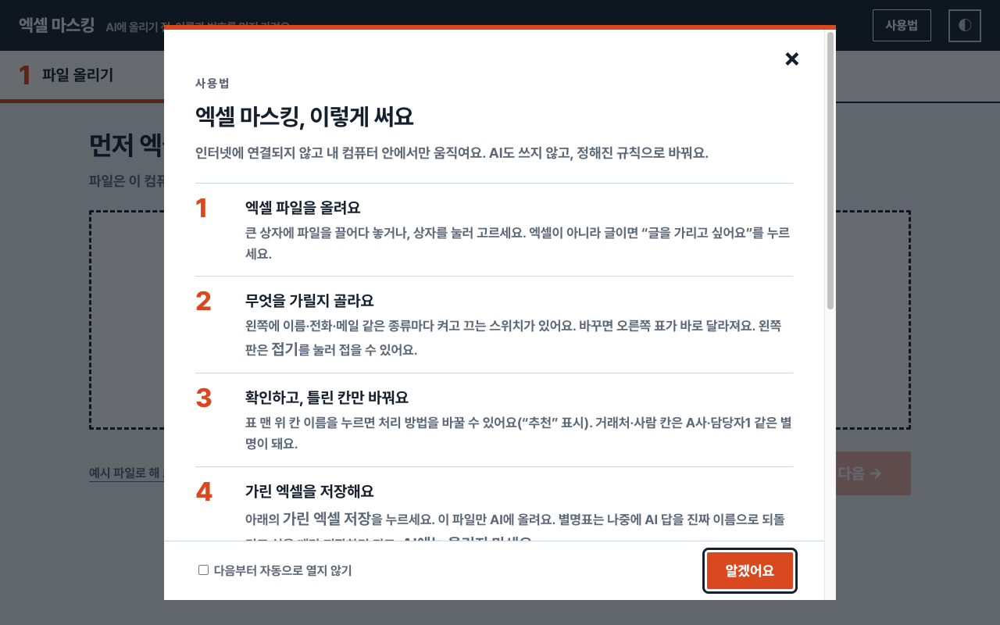
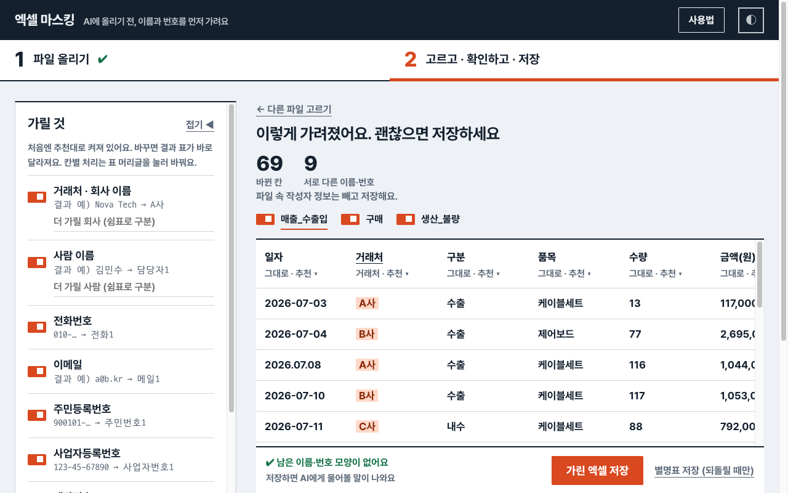
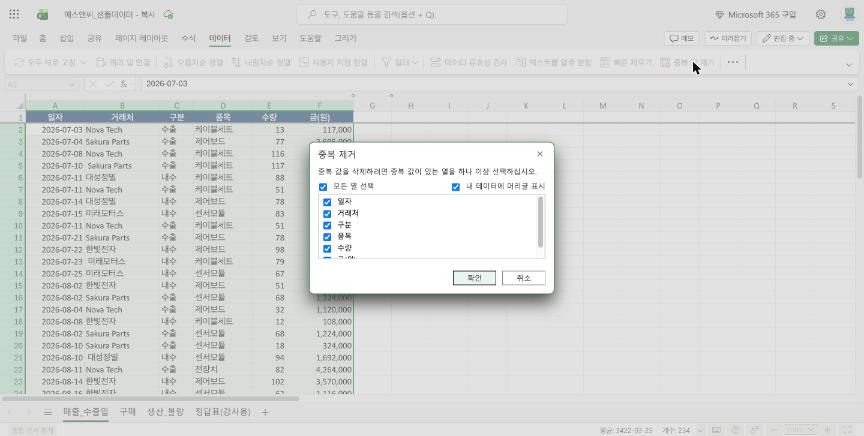
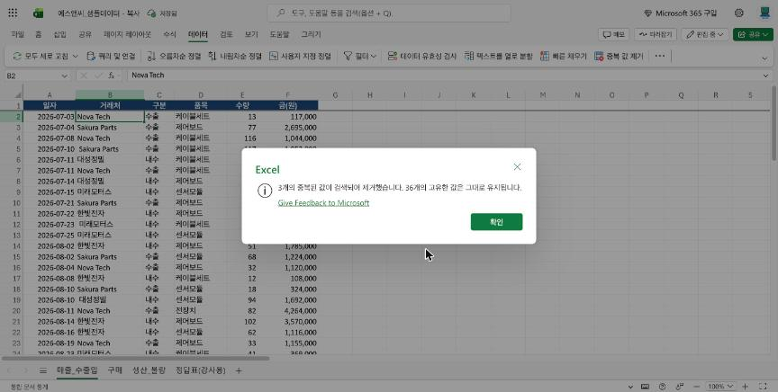

# 🧹 AI와 함께 표 정리하기

> ① 단계 · 29분 · 결과물: 깨끗한 매출표

**결론:** 표 정리는 "AI에게 방법을 묻고, 엑셀에서 적용하고, 숫자로 확인"하는 순서로 합니다. `매출_수출입` 시트에는 정리가 필요한 곳을 일부러 넣어 두었습니다. AI의 답이 **내 파일에서 맞는지** 확인하는 데 집중하세요.

**오늘의 진행 순서 (문제를 보고 해당 STEP을 따라 합니다)**

| STEP | 이런 문제가 있으면 | 할 일 | 시간 |
|---|---|---|---|
| 1 | 어디가 문제인지 모르겠다 | 표를 보고 문제 찾기 | 7분 |
| 2 | 금액에 "원" 글자가 붙어 있다 | "원" 글자 없애기 | 5분 |
| 3 | 날짜가 "2026.07.08"처럼 점으로 되어 있다 | 날짜 점(.)을 하이픈(-)으로 | 4분 |
| 4 | 이름 앞뒤에 빈칸이 있다 | 이름 앞뒤 빈칸 지우기 | 8분 |
| 5 | 똑같은 줄이 두 번 들어 있다 | 같은 줄 지우고 합계 확인하기 | 5분 |

<div data-callout="teacher">

**강사 메모:** 이 단계의 정답은 "중복 제거 후 36행"입니다. 숫자 하나로 맞았는지 확인할 수 있습니다. AI 답이 순서가 조금 달라도 괜찮습니다. 결과가 36행이면 맞는 길입니다. 참가자 파일(`_참가자용`)에는 정답표 시트가 없으니, 정답은 이 단계 STEP 5 끝의 합계 숫자(57,641,000)로 확인하게 해 주세요.

</div>

- 💻 웹 엑셀 (복사해 둔 샘플 파일)
- 💬 ChatGPT 또는 Gemini
- 🔒 엑셀 마스킹.html

* 지저분한 표의 문제를 AI와 함께 찾는다
* AI가 알려 준 방법을 엑셀에 적용한다
* 결과를 숫자로 확인한다

---

## STEP 1. 표를 보고 문제 찾기 ⏱7분

**결론:** 내가 먼저 문제를 찾고, AI가 찾은 것과 비교합니다.

1. 시트 탭에서 `매출_수출입` 을 누릅니다.
2. 위에서 아래로 스크롤하며 이상한 곳에 마음속으로 표시합니다.
3. 준비해 둔 `엑셀 마스킹.html`을 더블클릭해 엽니다. 처음에 뜨는 "사용법" 창은 **알겠어요**를 눌러 닫습니다. `에스앤씨_샘플데이터_참가자용.xlsx` 파일을 "엑셀 파일을 여기에 놓으세요" 칸에 놓습니다. 거래처 이름이 A사, B사 같은 별명으로 바뀝니다.





4. 오른쪽 아래 **가린 엑셀 저장**을 누릅니다. `에스앤씨_샘플데이터_참가자용_가림.xlsx`가 만들어집니다. 원본 파일은 수정하지 않습니다.
5. AI 화면에 **가린 파일**을 끌어다 놓고(첨부), 아래 말을 붙여 넣습니다.

```
너는 엑셀 데이터 정리를 잘하는 선배야.
첨부한 엑셀은 우리 회사 매출표야. 거래처 이름은 가려 놓았어.
엑셀에서 문제가 될 만한 곳을 찾아서, 문제 종류별로 표로 정리해줘.
(문제 | 어디에 있나 | 왜 문제인가)
```

<div data-callout="warning">

**첨부가 안 될 때:** 무료 AI는 파일 첨부 횟수에 제한이 있을 수 있습니다. 이때는 `_가림.xlsx`를 엑셀로 열어 `매출_수출입` 시트의 처음 10줄을 복사해 AI 입력창에 붙여 넣습니다.

</div>

<div data-callout="info">

**참고:** 실제 업무 자료는 이름을 가린 뒤 AI에 보냅니다. 이 순서(가리기 → AI에 올리기)를 습관으로 만드세요.

</div>

**내가 찾은 문제 (AI가 찾은 것과 비교합니다)**

\______

💡 예) 금액에 "원"이 붙어 있다 / 날짜가 점으로 되어 있다 / 이름 앞에 빈칸이 있다

---

✅ **체크리스트**
- [ ] 문제 종류를 2가지 이상 찾았다

---

## STEP 2. "원" 글자 없애기 ⏱5분

**결론:** 금액 칸의 데이터 부분만 골라 "원"을 바꾸기로 지웁니다.

**AI에게 물어보기**

```
엑셀에서 금액 칸에 "792,000원"처럼 "원" 글자가 붙어 있어.
"원"만 한 번에 지워서 숫자로 바꾸는 방법을 알려줘.
웹 엑셀 기준, 클릭 순서대로 번호를 붙여서.
```

AI는 "찾기 및 바꾸기"를 알려 줍니다. 아래 순서로 따라 합니다.

1. **금액 칸의 데이터 부분만** 고릅니다. 첫 칸(F2)을 누르고, 마지막 칸을 Shift를 누른 채 누릅니다.
2. 홈 > 찾기 및 선택 > 바꾸기를 누릅니다. (단축키 Ctrl+H)
3. "찾을 내용"에 `원`, "바꿀 내용"은 비워 둡니다.
4. 모두 바꾸기를 누릅니다.

<div data-callout="warning">

**주의:** 제목 칸(F1 "금액(원)")까지 고르면 제목의 "원"도 지워집니다. 반드시 데이터 칸만 고르세요.

</div>

<div data-callout="teacher">

**PC에 설치된 엑셀:** 같은 이름의 메뉴가 있습니다. 홈 > 찾기 및 선택 > 바꾸기. 구글 시트는 수정 > 찾기 및 바꾸기입니다.

</div>

**바뀐 건수**

\______

💡 예) 10개

---

✅ **체크리스트**
- [ ] 금액이 오른쪽 정렬된 숫자가 되었다

---

## STEP 3. 날짜 점(.)을 하이픈(-)으로 ⏱4분

**결론:** 점으로 쓴 날짜("2026.07.08")는 글자입니다. 하이픈으로 바꾸면 엑셀이 날짜로 인식합니다.

1. 일자 칸(A2부터 마지막 줄까지)을 고릅니다.
2. 바꾸기 창을 엽니다. (홈 > 찾기 및 선택 > 바꾸기)
3. "찾을 내용"에 `.`, "바꿀 내용"에 `-` 를 넣고 모두 바꾸기를 누릅니다.

먼저 위 방법으로 직접 해 본 뒤, 아래처럼 AI에게도 물어서 비교해 봅니다.

**AI에게 물어보기**

```
엑셀 날짜가 "2026.07.08"처럼 점으로 되어 있어서 월별 합계가 안 나와.
날짜로 바꾸는 가장 쉬운 방법을 알려줘.
```

**AI가 알려 준 방법은 위와 같았나요? 다른 점이 있으면 적습니다.**

\______

💡 예) 같았다 / 텍스트 나누기라는 다른 방법도 알려줬다

---

✅ **체크리스트**
- [ ] 모든 날짜가 같은 모양이고 오른쪽 정렬이 되었다 (왼쪽에 그대로 있으면 아직 글자)

---

## STEP 4. 이름 앞뒤 빈칸 지우기 ⏱8분

**결론:** 눈에 보이지 않는 앞뒤 빈칸은 TRIM 함수로 지웁니다. "Nova Tech"와 " Nova Tech"(앞에 빈칸)는 엑셀에서 **다른 거래처**로 집계되기 때문입니다.

**AI에게 물어보기**

```
거래처 이름 앞뒤에 눈에 안 보이는 빈칸이 있어.
빈칸을 지우는 엑셀 함수를 알려주고,
함수를 쓴 뒤 원래 칸에 결과를 덮어쓰는 방법까지
웹 엑셀 기준으로 번호를 붙여서 알려줘.
```

**따라 하기**

1. 빈 열(예: H열)의 H2를 누르고, H2부터 마지막 줄(H40)까지 Shift를 누른 채 고릅니다.
2. 아래 함수를 입력하고 **Ctrl+Enter** 를 누릅니다. 고른 칸 전부에 한 번에 들어갑니다.
   ```
   =TRIM(B2)
   ```
3. H열 결과를 모두 고르고 복사합니다. (Ctrl+C)
4. B2를 누르고 홈 > 붙여넣기 ▾ > **값만** 을 누릅니다.
5. H열을 지웁니다.

<div data-callout="info">

**참고:** TRIM의 결과는 **수식**이라 원래 칸에 그냥 붙이면 안 되고 **값만** 붙여야 합니다.

</div>

<div data-callout="warning">

**막혔을 때:** 이름 칸 박스(왼쪽 위 주소창)에 칸 범위를 입력하지 마세요. 웹 엑셀에서는 "이름 정의" 칸이라 엉뚱한 이름이 만들어집니다. 처음 칸을 누르고 Shift+클릭으로 범위를 고르세요.

</div>

<div data-callout="teacher">

**PC에 설치된 엑셀:** 붙여넣기 ▾ > 값(V) 또는 "값 붙여넣기"입니다. 막힐 때 드래그 대신 `H2` 클릭 후 `H40` Shift+클릭으로 안내하세요. 칸이 좁아 `########`가 보이면 열 폭을 넓히면 됩니다.

</div>

**지운 뒤 거래처 이름 종류 수**

\______

💡 예) 4종류 (Nova Tech, Sakura Parts, 대성정밀, 한빛전자 ...)

---

✅ **체크리스트**
- [ ] 이름 앞뒤 빈칸이 없어졌다

---

## STEP 5. 같은 줄 지우고 합계 확인하기 ⏱5분

**결론:** 똑같은 거래가 두 번 들어간 줄을 지우지 않으면 매출이 부풀려집니다. 중복 값 제거로 지운 뒤, 합계가 정답과 같은지 확인합니다.

**AI에게 물어보기**

```
엑셀 표에 완전히 똑같은 줄이 중복으로 들어가 있어.
한 번에 지우는 방법을 웹 엑셀 기준으로 알려줘.
지우기 전에 주의할 점도 알려줘.
```

**따라 하기**

1. 표 안의 아무 칸을 누릅니다.
2. 데이터 > 중복 값 제거를 누릅니다.
3. "내 데이터에 머리글 표시"에 체크가 되어 있고 모든 열이 체크됐는지 확인합니다.



4. 확인을 누릅니다. 안내 창에 "3개 제거, 36개 유지"가 나오면 성공입니다.



<div data-callout="info">

**참고:** "여섯 칸이 모두 같은 줄"만 지우므로 일부만 같은 줄은 남습니다. 단, STEP 4(빈칸 지우기)를 먼저 해야 같은 줄로 인식됩니다.

</div>

**지운 줄 수와 남은 줄 수**

\______

💡 예) 3개 제거, 36개 유지

**합계로 정답 확인하기**

5. 금액 칸 맨 아래 빈 칸(F38)에 `=SUM(F2:F37)` 을 입력하고 Enter를 누릅니다.
6. 합계가 **57,641,000** 과 같으면 STEP 2~5가 모두 맞게 된 것입니다.

**내 합계**

\______

💡 예) 57,641,000

<div data-callout="tip">

**참고:** 숫자가 다르면 어느 STEP에서 놓쳤는지 AI에게 묻습니다. 예: "내 합계가 57,641,000이 아니라 ○○인데 어디가 잘못됐을까?"

</div>

---

✅ **체크리스트**
- [ ] "3개 제거, 36개 유지"라는 안내가 나왔다
- [ ] 합계가 57,641,000과 같다

## 용어 사전

| 용어 | 쉬운 뜻 |
|---|---|
| 값만 붙여넣기 | 수식 말고 결과 글자만 붙이기 |
| TRIM | 앞뒤 빈칸을 지워 주는 함수 |