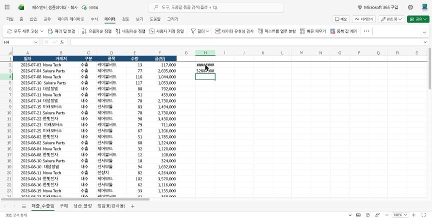
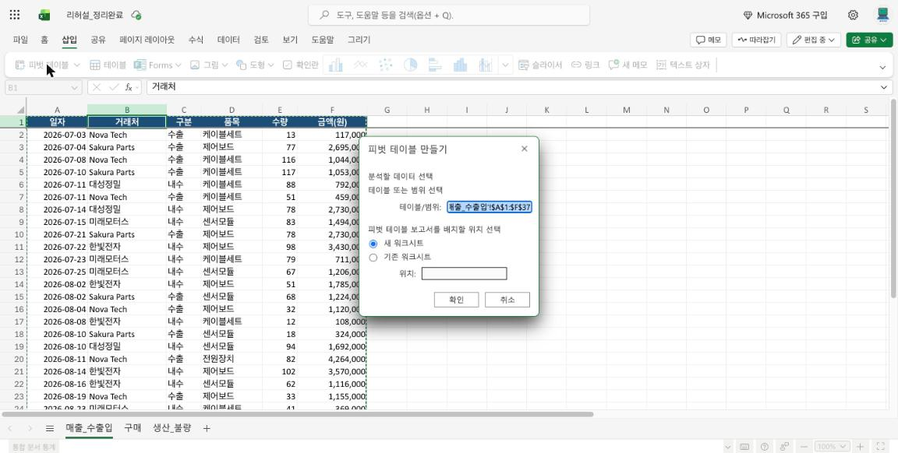
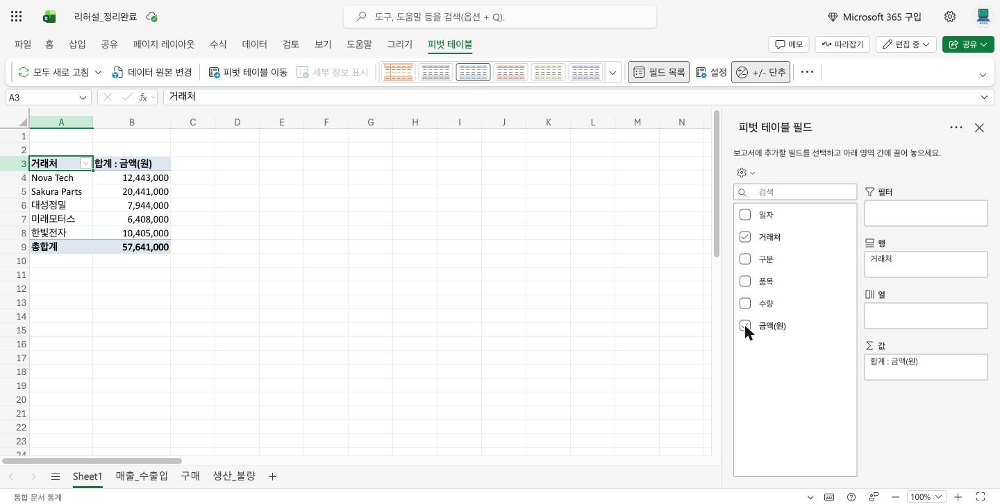
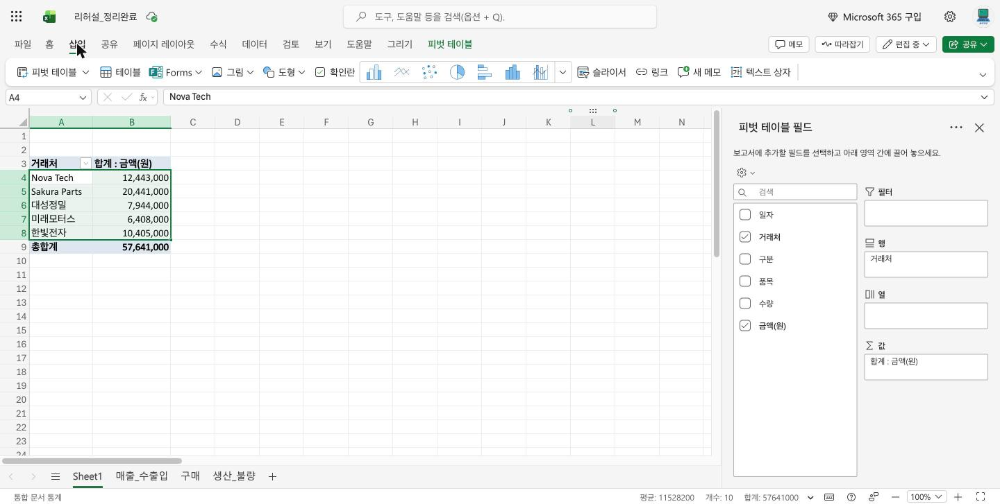
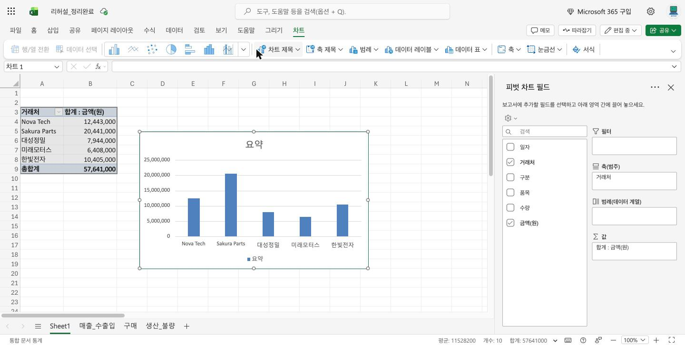

# 📊 AI에게 물어서 합계 내고 그래프 그리기

> ② 단계 · 35분 · 결과물: 집계표, 그래프, 불량률

**결론:** 합계는 "AI에게 수식을 묻고, 붙여 넣고, 정답과 맞춰 보는" 순서로 냅니다. 함수는 외우지 않고 AI에게 만들게 합니다.

**어떤 방법을 쓸까요?**

| 질문 | 예 | 아니오 |
|---|---|---|
| 조건 하나의 합계만 필요하다 | STEP 1~2 (SUMIFS) | STEP 3 (피벗) |
| 거래처처럼 항목이 많다 | STEP 3 (피벗 테이블) | 수식으로 충분 |
| 보고서에 그림이 필요하다 | STEP 4 (그래프) | 숫자표만 사용 |

<div data-callout="teacher">

**강사 메모:** 함수 이름(SUMIFS)을 외우게 하지 마세요. 핵심은 "AI에게 이렇게 물으면 함수를 만들어 준다"입니다. 정답: 수출 32,884,000 / 내수 24,757,000 / 7월 18,461,000 / 8월 20,647,000 / 9월 18,533,000. 피벗과 그래프 메뉴 이름은 실제 웹 엑셀에서 확인했습니다(2026-10-22). 정리 후 거래처는 5곳(Nova Tech 12,443,000 / Sakura Parts 20,441,000 / 대성정밀 7,944,000 / 미래모터스 6,408,000 / 한빛전자 10,405,000)이며, 가장 큰 곳은 Sakura Parts입니다. 피벗으로 만든 그래프는 "피벗 차트"라서 오른쪽 창 이름이 "피벗 차트 필드"로 바뀝니다.

</div>

- 💻 웹 엑셀 (① 단계에서 정리한 파일)
- 💬 ChatGPT 또는 Gemini

* 조건에 맞는 것만 더하는 수식을 AI에게 만들게 한다
* 같은 결과를 피벗 테이블로도 만든다
* 결과를 그래프로 그린다
* 생산 데이터로 불량률을 계산한다

## 오늘의 진행 순서 (한눈에 보기)

| STEP | 할 일 | 시간 |
|---|---|---|
| 1 | 구분별 합계 (AI가 만든 함수) | 6분 |
| 2 | 월별 합계 | 6분 |
| 3 | 피벗 테이블로 한 번에 | 7분 |
| 4 | 그래프 그리기 | 7분 |
| 5 | 생산 불량률 구하기 | 9분 |

---

## STEP 1. 구분별 합계 (AI가 만든 함수) ⏱6분

**결론:** 조건 합계는 함수가 필요하며, 열 이름과 범위만 정확히 알려 주면 AI가 만들어 줍니다.

**AI에게 물어보기** (열 이름을 정확히 알려 주는 것이 핵심입니다)

```
아래 조건에 맞는 엑셀 수식을 만들어줘.
- 표 위치: 매출_수출입 시트, 2행부터 37행까지
- C열은 구분(수출 또는 내수), F열은 금액
- 하고 싶은 것: 구분이 "수출"인 금액만 더하기
수식 한 줄과, 어느 칸에 어떻게 넣는지 쉽게 알려줘.
```

**따라 하기**

1. 빈 칸(예: H2)을 누릅니다.
2. AI가 알려 준 수식을 붙여 넣고 Enter를 누릅니다. 아래와 비슷한 수식이 나옵니다.
   ```
   =SUMIFS(F2:F37, C2:C37, "수출")
   ```
3. 같은 방법으로 "내수"도 구합니다.



<div data-callout="info">

**참고:** SUMIFS는 조건이 붙은 더하기입니다. "구분이 수출인 줄만 골라 금액을 더한다"는 뜻입니다.

</div>

| 구분 | 정답 | 내 숫자 |
|---|---|---|
| 수출 | 32,884,000 | |
| 내수 | 24,757,000 | |

<div data-callout="warning">

**주의:** 칸에 `########`가 보이면 칸이 좁은 것입니다. 열 이름 오른쪽 선을 끌어 넓히세요. 수식이 안 되면 AI에게 "이 수식을 넣었더니 ○○ 오류가 나옵니다"라고 그대로 알려 주세요.

</div>

---

✅ **체크리스트**
- [ ] 수출이 32,884,000으로 나왔다

---

## STEP 2. 월별 합계 ⏱6분

**결론:** 월별 합계는 날짜 범위(7월 1일 이상, 8월 1일 미만)를 조건으로 씁니다.

```
같은 표에서 월별 금액 합계를 구하고 싶어.
A열이 일자(날짜), F열이 금액이야. 2행부터 37행까지.
7월, 8월, 9월 합계를 각각 구하는 수식을 만들어줘.
날짜 조건을 쓰는 방법도 쉽게 설명해줘.
```

AI가 준 수식으로 7월, 8월, 9월을 구합니다.

**확인할 정답**

| 월 | 정답 | 내 숫자 |
|---|---|---|
| 7월 | 18,461,000 | |
| 8월 | 20,647,000 | |
| 9월 | 18,533,000 | |

<div data-callout="tip">

**확인:** 세 월을 더하면 57,641,000이어야 합니다. 다르면 ① 단계의 날짜 바꾸기를 놓친 것입니다.

</div>

**AI의 수식에서 모르겠던 부분 한 가지**

\______

💡 예) ">=" 와 "<" 가 무슨 뜻인지 몰라서 AI에게 다시 물어봤다

---

✅ **체크리스트**
- [ ] 세 달 합계를 더하면 57,641,000이다

---

## STEP 3. 피벗 테이블로 한 번에 ⏱7분

**결론:** 피벗 테이블은 함수 없이 체크만 하면 거래처별 합계표를 만들어 줍니다.

```
엑셀 피벗 테이블로 거래처별 금액 합계표를 만들고 싶어.
웹 엑셀 기준으로, 클릭 순서대로 번호를 붙여서 알려줘.
```

**따라 하기**

1. 표 안의 아무 칸을 누릅니다.
2. 위쪽 **삽입** 탭 > **피벗 테이블**을 누릅니다.
3. 창이 뜨면 범위가 `A1:F37`로 잡혔는지 보고, "새 워크시트"가 골라진 채 **확인**을 누릅니다.



4. 새 시트가 열리면 오른쪽 "피벗 테이블 필드"에서 **거래처**와 **금액(원)** 앞의 네모를 눌러 체크합니다. (거래처는 **행**, 금액은 **값**으로 자동으로 들어갑니다.)



표 맨 아래 **총합계가 57,641,000**이면 맞습니다.

<div data-callout="info">

**참고:** 피벗 테이블은 표를 요약해서 보여 주는 도구입니다. 원본 표는 바뀌지 않습니다.

</div>

<div data-callout="teacher">

**막힘 대비:** 피벗 이름 칸을 잘못 눌러 "유효한 섹션으로 항목 이동" 경고가 뜨면 확인을 누르고 다시 끌어다 놓으면 됩니다. 정리 전 파일이라면 "B"와 "B "가 따로 나오는 걸 보여 주며 ① 단계 TRIM이 왜 필요한지 설명하기 좋습니다. 원본을 고치면 피벗은 새로 고침(데이터 > 모두 새로 고침)을 눌러야 반영됩니다. 막히는 분은 이 STEP을 건너뛰고 STEP 4로 가도 됩니다.

</div>

**피벗 표에서 금액이 가장 큰 거래처는?**

\______

💡 예) Sakura Parts (20,441,000)

---

✅ **체크리스트**
- [ ] 거래처별 합계표가 만들어졌다

---

## STEP 4. 그래프 그리기 ⏱7분

**결론:** 비교는 막대, 변화는 선 그래프를 쓰고, 어떤 것이 맞는지는 AI에게도 물어봅니다.

```
수출/내수 금액 비교와 월별 금액 변화를 보여주고 싶어.
각각 어떤 그래프가 좋을지 이유와 함께 알려줘.
웹 엑셀에서 그리는 방법도 번호를 붙여서 알려줘.
```

**따라 하기**

1. 피벗 표에서 거래처 이름부터 금액까지 칸을 고릅니다. (첫 칸을 누르고 마지막 칸을 Shift+클릭. 총합계 줄은 빼세요.)
2. **삽입** 탭 줄에 그림 모양 차트 버튼들이 나란히 있습니다. AI가 추천한 종류(맨 왼쪽 세로 막대, 선 등)를 누릅니다.



3. 그래프가 나타납니다. 위쪽 **차트** 탭의 **차트 제목**에서 제목을 알아보기 쉽게 고칩니다. (처음엔 "요약"이라고 붙어요.)



<div data-callout="tip">

**확인:** 비교는 막대 그래프, 변화는 선 그래프가 기본입니다. AI 추천이 같은지 비교해 보세요.

</div>

**내가 만든 그래프가 말해 주는 것 한 문장**

\______

💡 예) 8월 매출이 가장 높고 수출이 내수보다 크다

---

✅ **체크리스트**
- [ ] 그래프에 제목과 값이 보인다

---

## STEP 5. 생산 불량률 구하기 ⏱9분

**결론:** 불량률은 라인 이름을 먼저 통일한 뒤, 불량 합계 ÷ 생산 합계로 구합니다. `생산_불량` 시트는 "A라인", "a라인", "B 라인"처럼 섞여 있습니다.

```
엑셀 생산_불량 시트에서 라인별 불량률을 구하고 싶어.
A열 일자, B열 라인, C열 제품, D열 생산수량, E열 불량수량이고 2행부터 31행까지야.
B열에는 "A라인", "a라인", "B 라인"처럼 대소문자와 빈칸이 섞여 있어.
이름을 통일한 열을 만드는 수식과, 라인별 불량률(불량수량 합계 ÷ 생산수량 합계)을 구하는 수식을 알려줘.
웹 엑셀 기준, 번호를 붙여서.
```

**따라 하기**

1. F1에 `라인정리`라고 쓰고, F2부터 F31까지 AI가 알려 준 수식을 넣습니다. 이런 모양의 수식이 나옵니다.
   ```
   =UPPER(SUBSTITUTE(B2," ",""))
   ```
2. 빈 곳에 라인별 생산수량 합계, 불량수량 합계를 SUMIFS로 구하고, 불량률 = 불량수량 ÷ 생산수량으로 계산합니다.
3. 불량률 칸은 홈 탭에서 **% 모양 버튼**을 눌러 퍼센트로 바꿉니다.

<div data-callout="info">

**주의:** 전체 불량률을 "라인 불량률의 평균"으로 구하면 틀립니다. 라인마다 생산량이 다르므로 **불량 합계 ÷ 생산 합계**로 구합니다.

</div>

**확인할 정답**

| 라인 | 생산수량 | 불량수량 | 불량률 |
|---|---|---|---|
| A라인 | 2,808 | 80 | 2.85% |
| B라인 | 4,622 | 144 | 3.12% |
| C라인 | 8,443 | 299 | 3.54% |
| 전체 | 15,873 | 523 | 3.29% |

**내 계산에서 달랐던 숫자와 이유**

\______

💡 예) A라인이 2,000대로 나왔다 → 소문자 a라인이 빠져서 그랬다

<div data-callout="teacher">

**강사 메모:** `생산_불량` 시트는 30줄이고 중복 줄은 없습니다. 이름 통일(대소문자·빈칸)을 놓치면 라인이 8종류로 나옵니다. AI가 `TRIM`과 `UPPER`를 함께 쓰라고 하면 정상입니다.

</div>

---

✅ **체크리스트**
- [ ] 전체 불량률이 3.29%로 나왔다

## 용어 사전

| 용어 | 뜻 |
|---|---|
| SUMIFS | 조건에 맞는 것만 더하는 함수 |
| 피벗 테이블 | 표를 요약해서 보여 주는 도구 |
| 불량률 | 불량 수량을 생산 수량으로 나눈 비율 |
| 새로 고침 | 원본이 바뀐 걸 요약본에 다시 반영하기 |
