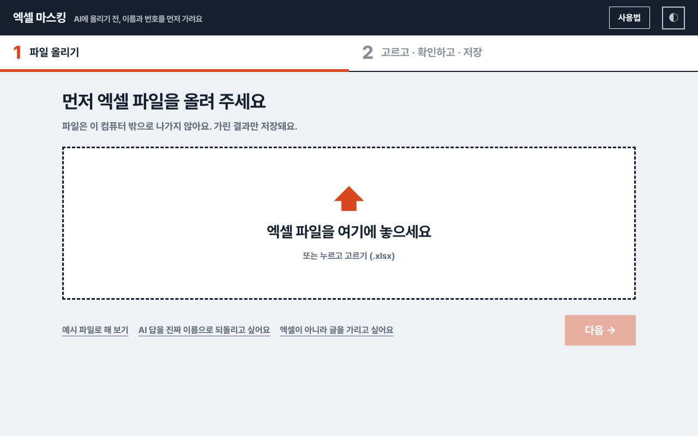
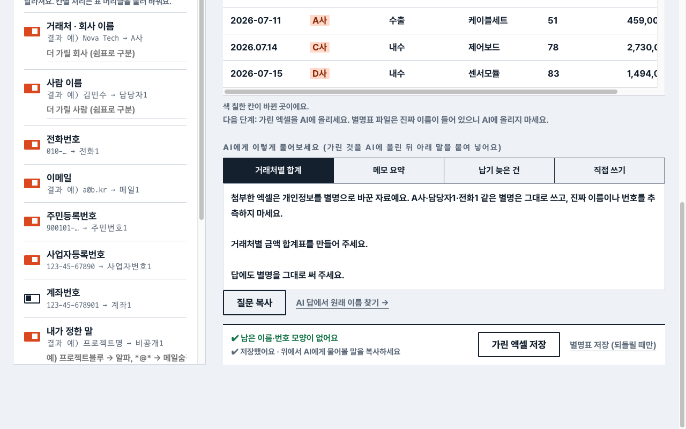
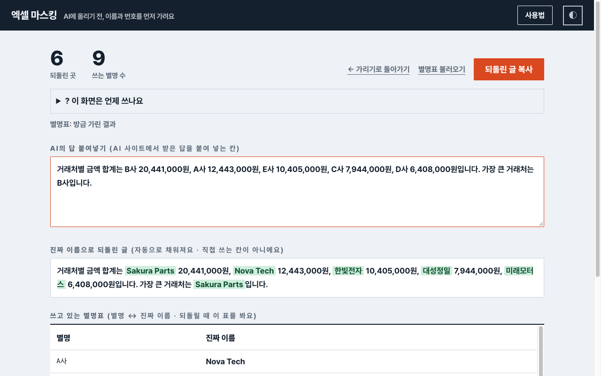

# 🔒 이름은 가리고, AI에게 분석은 맡기기

> ③ 단계 · 20분 · 결과물: 이름이 가려진 엑셀, ChatGPT·Gemini 답 비교

**결론:** 업무 자료는 이름을 가린 파일로 AI에게 분석을 맡기고, 받은 답은 진짜 이름으로 되돌려 씁니다. ChatGPT와 Gemini에 같은 질문을 해서 답을 비교합니다.

**이 자료를 AI에 올려도 되는가?**

| 질문 | 예 | 아니오 |
|---|---|---|
| 거래처·사람 이름이 보인다 | 먼저 가린다 (STEP 1) | 그대로 올린다 |
| 가린 뒤에도 이름이 남아 있다 | 그 열은 지우고 올린다 (STEP 4) | 그대로 올린다 |
| AI 답을 보고서에 쓴다 | 진짜 이름으로 되돌린다 (STEP 3) | 참고용으로만 본다 |

**강사 메모:** ① 단계에서 이미 `_가림.xlsx`를 만들었으니 여기서는 복습 수준으로 짧게 넘기세요. 가림 파일은 정리 전 데이터라 줄이 39개(중복 3줄 포함)이고 금액 중 일부가 "792,000원" 같은 글자입니다. AI가 낸 총합은 정리 후 정답(57,641,000)과 달라도 정상입니다. 그 차이가 "AI 답은 꼭 확인한다" 약속을 보여 주는 좋은 장면이에요. 별명표는 A사 Nova Tech / B사 Sakura Parts / C사 대성정밀 / D사 미래모터스 / E사 한빛전자 / F사 우리케미칼 / G사 동양포장 / H사 대한금속 / I사 세진전자 입니다(앱에서 확인). 무료 AI에 엑셀 첨부가 안 되면 ① 단계 경고 박스의 "처음 10줄 붙여 넣기"로 대신하세요. 한 가지 AI만 열리는 PC는 그 AI 하나로 STEP 2를 진행하고, 비교는 옆 사람 화면과 하세요.

- 💻 `엑셀 마스킹.html`, ① 단계에서 저장한 `에스앤씨_샘플데이터_참가자용_가림.xlsx`
- 💬 ChatGPT와 Gemini (둘 중 하나여도 됩니다)

* 이름을 가린 파일로 AI에게 분석을 맡긴다
* 같은 질문의 답을 두 AI에서 비교한다
* AI 답의 별명을 진짜 이름으로 되돌린다

## 오늘의 진행 순서 (한눈에 보기)

| STEP | 할 일 | 시간 |
|---|---|---|
| 1 | 가린 파일 준비하고 질문 복사하기 | 5분 |
| 2 | ChatGPT와 Gemini에 같은 질문하기 | 7분 |
| 3 | 답을 진짜 이름으로 되돌리기 | 5분 |
| 4 | 가려지지 않은 게 없는지 확인하기 | 3분 |

---

## STEP 1. 가린 파일 준비하고 질문 복사하기 ⏱5분

**결론:** 가린 파일과 복사한 질문, 두 가지가 준비되어야 AI에게 보낼 수 있습니다.

① 단계에서 만든 `에스앤씨_샘플데이터_참가자용_가림.xlsx`가 있으면 그대로 씁니다. 없으면 `엑셀 마스킹.html`을 열고 파일을 놓은 뒤 **가린 엑셀 저장**을 누릅니다.

1. 가리기 화면을 엽니다. 왼쪽에서 **거래처 · 회사 이름** 스위치가 켜져 있는지 확인합니다. 표의 거래처 칸이 A사, B사로 바뀌어 있어야 합니다.
2. 저장한 뒤 표 아래쪽에 **AI에게 이렇게 물어보세요** 칸이 나옵니다. **거래처별 합계** 탭을 누르고 **질문 복사**를 누릅니다.

3. 복사한 질문은 STEP 2에서 두 AI에 똑같이 붙여 넣습니다.

**참고:** 이름 가리기는 진짜 이름을 A사 같은 별명으로 바꾸는 일입니다. 별명과 진짜 이름의 짝을 적은 파일이 **별명표**이며, 내 컴퓨터에만 보관합니다.

---

✅ **체크리스트**
- [ ] 거래처 칸이 A사, B사로 보이고 질문을 복사했다

---

## STEP 2. ChatGPT와 Gemini에 같은 질문하기 ⏱7분

**결론:** 두 AI에 같은 파일, 같은 질문을 넣고 답을 나란히 비교합니다.

1. ChatGPT에 `_가림.xlsx`를 끌어다 놓고, 복사한 질문을 붙여 넣어 보냅니다.
2. Gemini에도 똑같이 합니다.
3. 두 답이 오면 숫자와 표 모양을 비교합니다.

**주의:** 파일 첨부가 안 되면 `_가림.xlsx`를 엑셀로 열어 `매출_수출입` 시트의 앞부분을 복사해 질문 아래에 붙여 넣습니다. 별명표 파일에는 진짜 이름이 들어 있으므로 **AI에 올리지 않습니다.**

**두 AI의 답에서 다른 점 한 가지**

\______

💡 예) ChatGPT는 B사가 가장 크다고 했고, Gemini는 금액을 표로 정리해 줬다

**확인:** 숫자가 서로 다르면 둘 중 하나가 틀린 것입니다. ② 단계에서 만든 피벗 표와 맞춰 보면 알 수 있습니다. 이 파일은 정리 전 자료라 정답과 다를 수 있습니다.

---

✅ **체크리스트**
- [ ] 두 AI의 답을 나란히 보았다

---

## STEP 3. 답을 진짜 이름으로 되돌리기 ⏱5분

**결론:** AI 답의 별명(A사, B사)은 보고서에 쓰기 전에 진짜 이름으로 바꿉니다.

1. 마스킹 화면 아래의 **AI 답에서 원래 이름 찾기 →**를 누릅니다. (처음 화면의 "AI 답을 진짜 이름으로 되돌리고 싶어요"로도 들어갈 수 있습니다.)
2. 위쪽 칸에 AI가 준 답을 붙여 넣습니다.
3. 아래 칸에 진짜 이름으로 바뀐 글이 나오면 **되돌린 글 복사**를 누릅니다.

**참고:** 방금 가리기를 했다면 별명표를 따로 불러오지 않아도 됩니다. 화면을 닫았다가 나중에 되돌릴 때만 저장해 둔 별명표 파일을 **별명표 불러오기**로 가져옵니다.

| 별명 | 진짜 이름 |
|---|---|
| B사 | Sakura Parts |
| A사 | Nova Tech |

**되돌린 글에서 가장 금액이 큰 거래처 이름**

\______

💡 예) Sakura Parts

---

✅ **체크리스트**
- [ ] 되돌린 글에 진짜 거래처 이름이 나왔다

---

## STEP 4. 가려지지 않은 게 없는지 확인하기 ⏱3분

**결론:** 도구는 정해진 규칙으로만 가리므로, 보내기 전에 눈으로 한 번 더 확인합니다.

1. `_가림.xlsx`의 세 시트(`매출_수출입`, `구매`, `생산_불량`)를 열어 이름이 남아 있는지 훑어봅니다.
2. 가려지지 않았는데 숨기고 싶은 칸이 있으면, 그 열은 지우고 보냅니다.

**꼭 기억하세요:** 가린 파일은 보내기 전에 사람이 마지막으로 확인합니다. 도구가 못 찾는 이름이 있을 수 있습니다.

---

✅ **체크리스트**
- [ ] 보내기 전에 눈으로 한 번 더 확인하는 습관을 알았다

## 용어 사전

| 용어 | 뜻 |
|---|---|
| 별명표 | 별명(A사)과 진짜 이름의 짝을 적은 파일 |
| 되돌리기 | AI 답의 별명을 진짜 이름으로 다시 바꾸는 것 |
