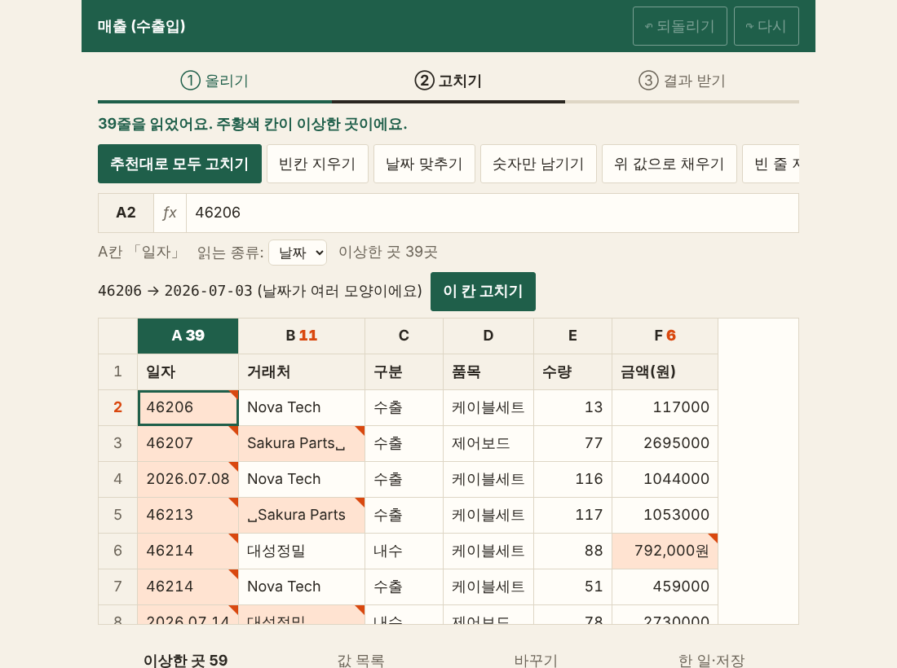
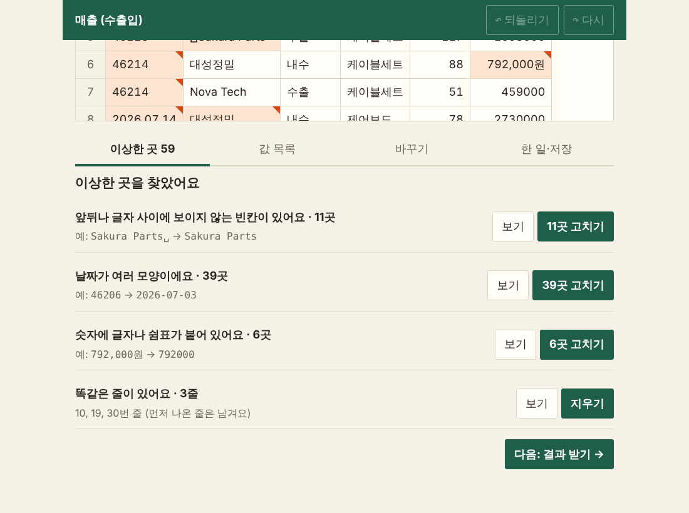
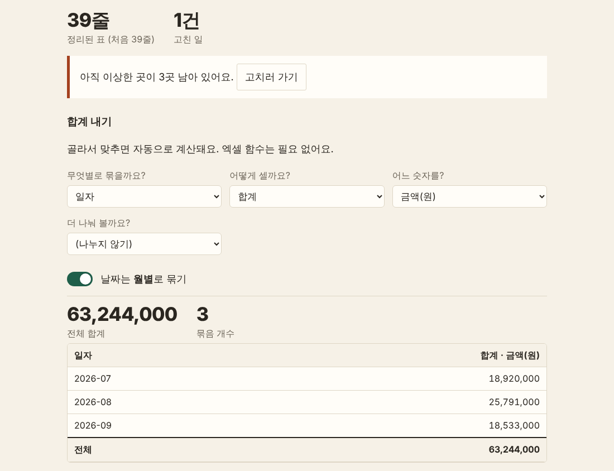
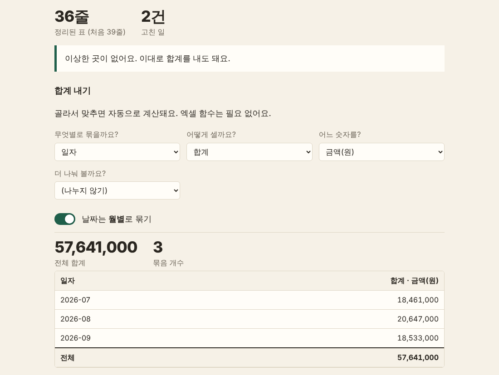
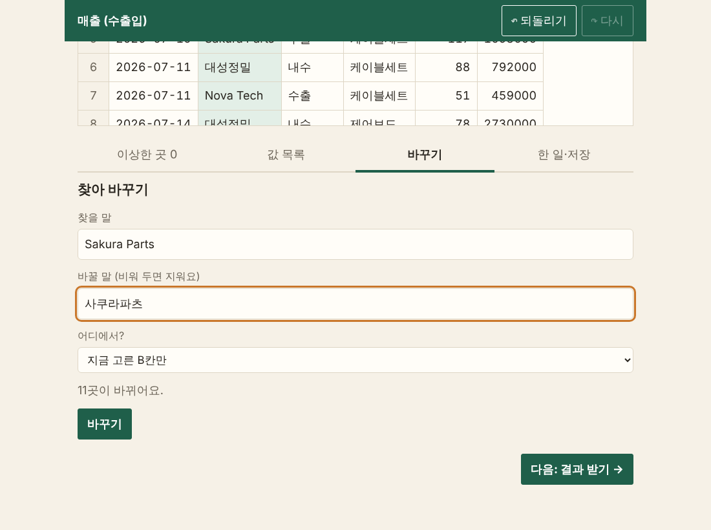
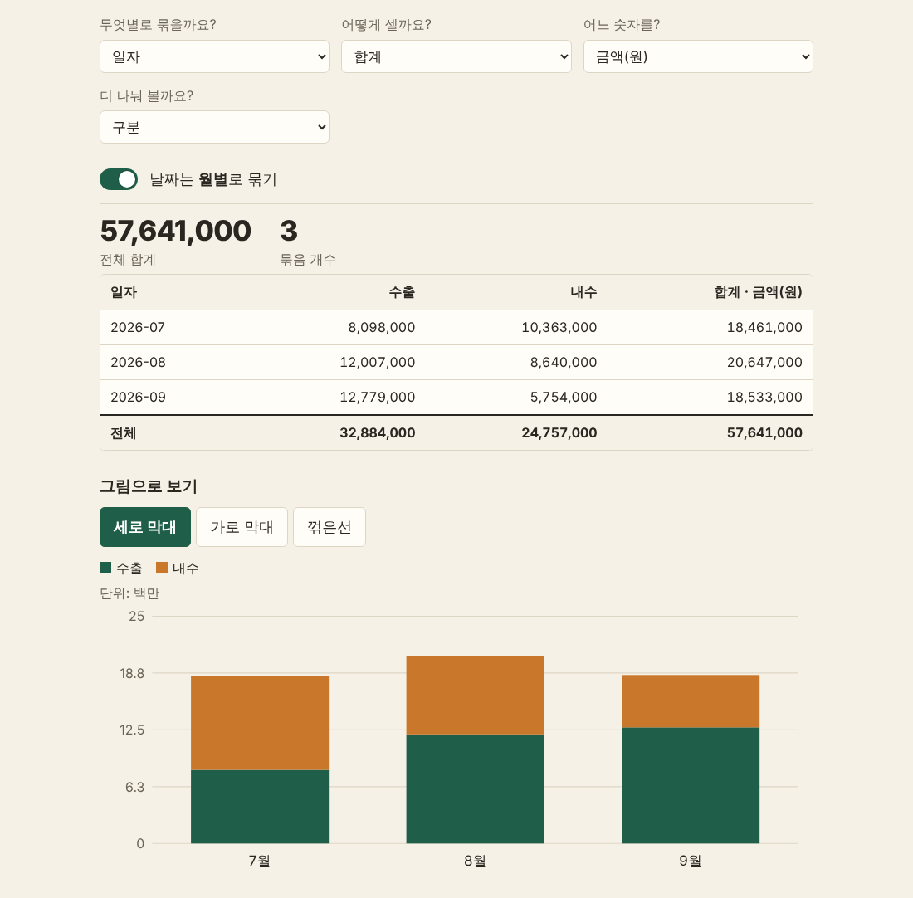
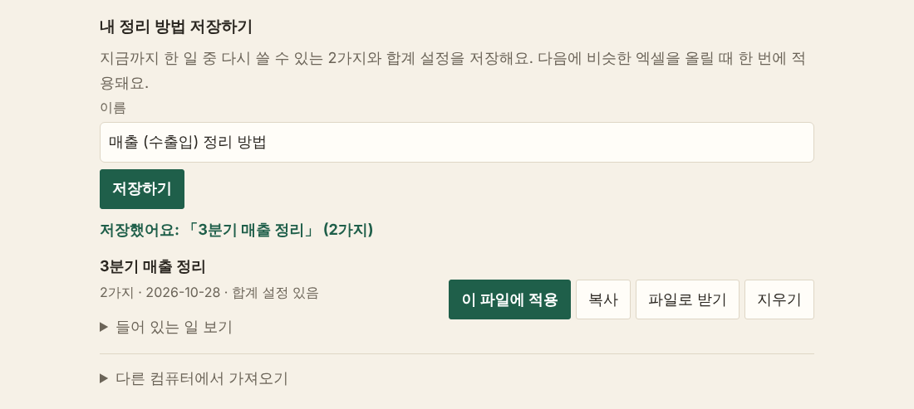

# 📊 엑셀 데이터 정리 및 자동 집계

> ① 단원 · 60분(휴식 10분 포함) · 결과물: 깨끗한 표, 월별·구분별 합계, 저장해 둔 "내 정리 방법"

이 문서만 보고 따라 하면, 지저분한 엑셀 표를 **`1_정리집계앱.html`** 로 정리하고, 월별·구분별 합계를 내고, 그 정리 방법을 **저장해서 다음 달 파일에 한 번에 적용**하는 것까지 완성합니다. 앱은 인터넷 없이 내 컴퓨터 안에서만 돌아가고, **원본 파일은 절대 바뀌지 않아요.**

<div data-callout="info">

**🎓 자격증 연결:** 이 단원은 연습 문제 **7번(AI에 넣기 전 데이터 정리)** 과 **8번(AI 도입 효과를 숫자로 확인)** 으로 이어집니다.

</div>

## 시작하기 전에 준비하세요

- [ ] `1_정리집계앱.html` 파일 (더블클릭하면 브라우저에서 열려요)
- [ ] 앱 화면 위쪽에 **초록 줄**과 `① 올리기 ② 고치기 ③ 결과 받기` 세 단계가 보이는지 확인
- [ ] (선택) `에스앤씨_샘플데이터_참가자용.xlsx` — 앱에 직접 올려 볼 엑셀 파일
- [ ] 시간을 재 볼 수 있는 휴대폰 타이머 (STEP 7에서 사용)

## 오늘의 진행 순서 (한눈에 보기)

| STEP | 할 일 | 시간 |
|---|---|---|
| 1 | 앱 열고 연습용 매출 자료 올리기 | 5분 |
| 2 | 이상한 곳 찾고 한 번에 고치기 | 8분 |
| 3 | 똑같은 줄 지우고 합계가 달라지는 것 확인하기 | 7분 |
| 4 | 다르게 쓴 같은 값 하나로 합치기 | 8분 |
| ☕ | 휴식 | 10분 |
| 5 | 직접 고치기, 바꾸기, 되돌리기 | 7분 |
| 6 | 월별·구분별 합계 내고 그래프 보기 | 8분 |
| 7 | "내 정리 방법" 저장하고 효과를 숫자로 재기 | 7분 |

---

## STEP 1. 앱 열고 연습용 매출 자료 올리기 (5분)

연습용 자료는 일부러 지저분하게 만든 **가짜 매출표**입니다. 실제 회사 이름이 아니에요.

**따라 하기**

1. `1_정리집계앱.html`을 더블클릭해 여세요.
2. 맨 위 초록 줄에 `① 엑셀 정리·집계 도우미`가 보이고, 아래에 `① 올리기 / ② 고치기 / ③ 결과 받기`가 보이면 정상이에요.
3. 화면 아래쪽 **"연습용 자료로 해 보기"** 에서 **`매출 (수출입)`** 버튼을 누르세요.
4. 화면이 바뀌면서 `39줄을 읽었어요. 주황색 칸이 이상한 곳이에요.`라는 안내가 나오는지 확인하세요.



💡 **쉬운 설명/예시:** 이 화면은 엑셀과 똑같이 생겼어요.
- 맨 위 줄 **A, B, C…** 는 열 이름이고 왼쪽 **1, 2, 3…** 은 줄 번호예요.
- **1번 줄**은 칸 이름(`일자 / 거래처 / 구분 / 품목 / 수량 / 금액(원)`)이에요.
- **주황색 칸**(모서리에 작은 삼각형)이 앱이 "이상하다"고 본 칸이에요.
- 내 엑셀 파일을 올릴 때는 파일을 **끌어다 놓거나** 칸을 눌러 고르세요. 표 위에 제목·작성자 줄이 있으면 앱이 **칸 이름 줄을 고르는 화면**을 보여 줘요. (파일은 컴퓨터 밖으로 나가지 않아요.)

📝 **직접 입력해보기** — 화면에서 직접 찾아보세요.

| 찾아볼 것 | 어느 칸/어떤 모양? (예시) | 내가 찾은 것 |
|---|---|---|
| 날짜가 숫자로 보이는 칸 | A칸 `46206` | |
| 날짜가 점(.)으로 적힌 칸 | A칸 `2026.07.08` | |
| 글자 뒤에 빈칸이 붙은 칸 | B칸 `Sakura Parts␣` (␣는 빈칸 표시) | |
| 금액에 "원"과 쉼표가 붙은 칸 | F칸 `792,000원` | |

---

✅ **체크리스트**
- [ ] 앱이 열리고 `39줄을 읽었어요`가 보인다
- [ ] 주황색 칸을 눈으로 4가지 모양 중 두 가지 이상 찾았다

---

## STEP 2. 이상한 곳 찾고 한 번에 고치기 (8분)

AI에게 분석을 시키기 **전에** 표부터 깨끗하게 해야 합니다. 지저분한 표를 넘기면 AI도 틀린 결과를 내요.

**따라 하기**

1. 화면 아래 탭에서 **`이상한 곳 59`** 가 선택되어 있는지 보세요. (탭 이름 옆 숫자는 이상한 곳의 개수예요.)
2. 목록에 나오는 종류와 개수를 읽어 보세요.

   | 종류 | 개수 | 예 |
   |---|---|---|
   | 앞뒤나 글자 사이에 보이지 않는 빈칸이 있어요 | 11곳 | `Sakura Parts␣` → `Sakura Parts` |
   | 날짜가 여러 모양이에요 | 39곳 | `46206` → `2026-07-03` |
   | 숫자에 글자나 쉼표가 붙어 있어요 | 6곳 | `792,000원` → `792000` |
   | 똑같은 줄이 있어요 | 3줄 | 10, 19, 30번 줄 |

3. 첫 줄 오른쪽의 **[보기]** 를 눌러 보세요. 앱이 해당 칸으로 이동해 표시해 줘요.
4. 표에서 **A2 칸**(날짜가 `46206`인 칸)을 누르세요. 표 위에 `46206 → 2026-07-03 (날짜가 여러 모양이에요)`와 **[이 칸 고치기]** 버튼이 나옵니다. 눌러 보세요.
5. 이제 맨 위 도구 줄의 **[추천대로 모두 고치기]** 를 누르세요.
6. `했어요: 추천대로 모두 고치기`가 나오고, 탭이 **`이상한 곳 3`** 으로 줄었는지 확인하세요. 남은 3곳은 **똑같은 줄 3줄**이에요.



![앱① 화면: [추천대로 모두 고치기] 뒤에는 '이상한 곳 3'(똑같은 줄 3줄)만 남아요](images/앱1_03_추천후_이상한곳3.png)

💡 **쉬운 설명/예시:** 엑셀의 날짜는 사실 숫자예요. `46206`은 "2026년 7월 3일"을 숫자로 센 값이고, 파일에 따라 `2026.07.03`, `2026/07/03`처럼 **모양이 섞여** 있어요. 모양이 섞이면 "월별 합계"가 제대로 묶이지 않아요. 그래서 한 가지 모양(`2026-07-03`)으로 통일하는 거예요.

<div data-callout="warning">

**주의:** [추천대로 모두 고치기]는 **빈칸, 날짜, 숫자, 띄어쓰기만 다른 같은 값**만 고쳐요. **똑같은 줄 지우기**와 **비슷한 값 합치기(서울/서울시)** 는 내가 직접 확인하고 누르게 해 두었어요. 지워지면 안 되는 줄이 있을 수 있으니까요.

</div>

<div data-callout="info">

**🎓 자격증 연결 (7번):** AI에게 엑셀 자료를 분석시키기 전에 **가장 먼저** 할 일은 **중복, 빈칸, 표기 흔들림(예: 서울/서울시)을 정리하는 것**이에요. 그래프 색을 고르거나 자료를 늘리는 것이 아니에요. 데이터가 지저분하면 AI도 틀린 결과를 냅니다.

</div>

📝 **직접 입력해보기**

| 질문 | 내 답 |
|---|---|
| 고치기 전 `이상한 곳`은 몇 곳이었나요? (정답: 59) | |
| [추천대로 모두 고치기] 뒤 남은 곳은 몇 곳, 무엇인가요? | |
| 내 업무 엑셀에서 비슷하게 지저분한 점 한 가지는? | |

---

✅ **체크리스트**
- [ ] `이상한 곳 59`가 `이상한 곳 3`으로 줄었다
- [ ] 남은 3곳이 "똑같은 줄"이라는 것을 확인했다
- [ ] 날짜가 왜 한 모양으로 통일되어야 하는지 한 문장으로 말할 수 있다

---

## STEP 3. 똑같은 줄 지우고 합계가 달라지는 것 확인하기 (7분)

똑같은 줄이 두 번 들어 있으면 **합계가 부풀어요.** 직접 숫자로 확인해 봅니다.

**따라 하기**

1. 화면 위쪽 `③ 결과 받기`를 누르세요.
2. `아직 이상한 곳이 3곳 남아 있어요`라는 안내와, 아래 **"합계 내기"** 가 보입니다.
3. **"무엇별로 묶을까요?"** 에서 `일자`를, **"날짜는 월별로 묶기"** 스위치를 켠 상태로 두세요.
4. 화면에 나온 **전체 합계**를 아래 표에 적으세요. (`63,244,000`이 보일 거예요.)
5. 안내 상자의 **[고치러 가기]** 를 눌러 ② 고치기로 돌아오세요.
6. 도구 줄의 **[같은 줄 지우기]** 를 누르세요. `했어요: 같은 줄 지우기`가 나오고 탭이 `이상한 곳 0`이 됩니다.
7. 다시 `③ 결과 받기`로 가서 **전체 합계**를 보세요. 이번에는 `57,641,000`이에요.





💡 **쉬운 설명/예시:** 월별 합계가 이렇게 달라졌어요.

| 월 | 지우기 전 | 지운 뒤 | 부풀었던 금액 |
|---|---:|---:|---:|
| 2026-07 | 18,920,000 | 18,461,000 | 459,000 |
| 2026-08 | 25,791,000 | 20,647,000 | 5,144,000 |
| 2026-09 | 18,533,000 | 18,533,000 | 0 |
| **전체** | **63,244,000** | **57,641,000** | **5,603,000** |

똑같은 줄 **3줄 때문에 5,603,000원**이 더 나온 거예요. 보고서에 이 숫자가 그대로 들어갔다면 임원이 잘못된 숫자로 결정했을 거예요.

📝 **직접 입력해보기**

| 항목 | 내가 본 숫자 |
|---|---|
| 지우기 전 전체 합계 | |
| 지운 뒤 전체 합계 | |
| 차이 (지우기 전 − 지운 뒤) | |

---

✅ **체크리스트**
- [ ] 지우기 전 `63,244,000`, 지운 뒤 `57,641,000`을 직접 보았다
- [ ] 차이가 `5,603,000`임을 계산했다
- [ ] "중복을 지우지 않으면 합계가 부풀 수 있다"를 말할 수 있다

---

## STEP 4. 다르게 쓴 같은 값 하나로 합치기 (8분)

**서울 / 서울시 / 서울 본점**처럼 같은 곳을 다르게 적으면 **다른 값으로 세어져요.** 이번에는 내가 직접 붙여넣을 **작은 연습표**로 합쳐 봅니다.

**따라 하기**

1. 아래 연습표를 **전체 선택해서 복사(Ctrl+C)** 하세요. (칸 사이는 탭이에요. 그대로 복사하면 됩니다.)

   ```
   지점	상품	수량	금액
   서울	사과	3개	12,000원
   서울시	사과	2	8000
   서울 본점	배	5	15000
   부산	배	5	15000
   부산시	포도	1	5000
   서울	포도	4	9000
   ```

2. `① 올리기`로 돌아가 **"파일이 안 열리면"** 아래의 붙여넣기 칸에 **붙여넣기(Ctrl+V)** 하세요. (화면에서 `엑셀에서 표를 드래그해 복사… → 여기에 붙여넣기`라고 쓰인 칸이에요.)
3. `② 고치기`가 열리면 탭의 `이상한 곳`에서 **"같은 뜻 같은데 다르게 적었어요 · 3곳"** 을 찾으세요. 예는 `서울시 → 서울`이에요.
4. 그 줄의 **[값 목록에서 고르기]** 를 누르세요. 탭이 **`값 목록`** 으로 바뀌고 이렇게 보입니다.

   | 값 | 개수 |
   |---|---:|
   | 서울 | 2개 |
   | 서울시 | 1개 |
   | 서울 본점 | 1개 |
   | 부산 | 1개 |
   | 부산시 | 1개 |

5. 앱이 `서울`, `서울시`, `서울 본점`에 **체크**를 해 두고, "모두 이 말로 바꾸기" 칸에 `서울`이 들어가 있어요. **[체크한 값 합치기]** 를 누르세요.
6. `했어요: A칸 3가지 값을 「서울」로 합치기`가 나옵니다. 이번엔 **[비슷한 값 자동으로 고르기]** 를 한 번 더 누르면 `부산`, `부산시`가 체크돼요. 다시 **[체크한 값 합치기]** 를 누르세요.
7. 값 목록이 `서울 4개 / 부산 2개` 두 줄로 줄었는지 확인하세요.

![앱① 화면: 탭 '값 목록'. 서울, 서울시, 서울 본점에 체크가 되어 있고 [체크한 값 합치기]를 누르면 돼요](images/앱1_06_값목록_합치기.png)

💡 **쉬운 설명/예시:** 앱은 "한 글자라도 다르면 다른 값"으로 세요. 사람 눈에는 같은 서울이지만 합계표에서는 **서울 / 서울시 / 서울 본점이 세 줄**로 갈라져요. **값 목록**은 "내 표에 어떤 값이 몇 개 있는지"를 한눈에 보여 주고, 같은 뜻의 값을 **체크해서 하나로 합치는** 도구예요.

📝 **직접 입력해보기** — 내 업무 표에서 비슷하게 갈라질 만한 값을 떠올려 적어 보세요.

| 칸 | 같은 뜻인데 다르게 적힌 값 (예시: 지점 칸의 서울 / 서울시) | 하나로 합칠 이름 |
|---|---|---|
| | | |

---

✅ **체크리스트**
- [ ] 값 목록에서 `서울 4개 / 부산 2개`가 되었다
- [ ] "한 글자라도 다르면 다른 값으로 센다"를 설명할 수 있다
- [ ] 내 업무 표에서 합쳐야 할 값 한 가지를 적었다

## ☕ 휴식 (10분)

---

## STEP 5. 직접 고치기, 바꾸기, 되돌리기 (7분)

앱이 못 잡는 것은 **내 손으로** 고칩니다. 잘못 눌러도 괜찮아요. **맨 위 [↶ 되돌리기]** 는 항상 보여요.

**따라 하기**

1. `① 올리기`에서 **`매출 (수출입)`** 을 다시 눌러 올리고, **[추천대로 모두 고치기]** → **[같은 줄 지우기]** 를 차례로 누르세요. (STEP 3과 같은 모습이 됩니다. `이상한 곳 0`)
2. 표에서 **A2 칸**을 누르고, 표 위 수식줄(`fx` 옆 입력칸)에서 `2026-07-03`을 `2026-07-30`으로 고친 뒤 **Enter**를 누르세요. 칸이 노란색으로 바뀌어요.
3. 맨 위 **[↶ 되돌리기]** 를 누르세요. 칸이 `2026-07-03`으로 돌아갑니다. **[↷ 다시]** 를 누르면 다시 `2026-07-30`이 돼요. 한 번 더 **[↶ 되돌리기]** 로 되돌려 두세요.
4. 표 맨 위의 **`B`** 글자(거래처 칸)를 눌러 B칸을 고르세요. 그다음 탭에서 **`바꾸기`** 를 누르고 아래처럼 쓰세요.

   | 칸 | 입력할 것 |
   |---|---|
   | 찾을 말 | `Sakura Parts` |
   | 바꿀 말 | `사쿠라파츠` |
   | 어디에서? | `지금 고른 B칸만` (B칸 = 거래처) |

   바로 아래에 `11곳이 바뀌어요.`가 나옵니다. **[바꾸기]** 를 누르세요.
5. 탭 **`한 일·저장`** 에 지금까지 한 일이 순서대로 나옵니다. **[↶ 되돌리기]** 를 눌러 마지막 일(바꾸기)을 취소하세요.



💡 **쉬운 설명/예시:** 엑셀에서 Ctrl+Z가 되돌리기죠. 이 앱의 **[↶ 되돌리기]** 도 같아요. 마지막에 한 일부터 하나씩 취소됩니다. **한 일 기록**을 보면 내가 무엇을 눌렀는지 알 수 있어서, 실수한 곳을 찾기 쉬워요.

<div data-callout="info">

**참고:** 칸을 **직접 고친 것**과 **줄 하나를 지운 것**은 "한 일 기록"에 `(저장 안 돼요)`라고 나와요. 줄 번호나 칸 위치는 **다음 달 파일에서는 달라지기** 때문이에요. 저장되는 일(추천 고치기, 같은 줄 지우기, 값 합치기, 바꾸기)은 STEP 7에서 써요.

</div>

📝 **직접 입력해보기**

| 질문 | 내 답 |
|---|---|
| 직접 고친 칸은 어떤 색으로 바뀌었나요? | |
| `Sakura Parts`를 바꾸면 몇 곳이 바뀐다고 나왔나요? (정답: 11) | |

---

✅ **체크리스트**
- [ ] 수식줄에서 칸 하나를 고치고 [↶ 되돌리기]로 되돌렸다
- [ ] `바꾸기` 탭에서 `11곳이 바뀌어요`를 확인했다
- [ ] `한 일·저장` 탭에서 내가 한 일 목록을 보았다

---

## STEP 6. 월별·구분별 합계 내고 그래프 보기 (8분)

엑셀 함수(SUMIFS 같은 것)를 몰라도, **골라서 맞추면** 합계가 계산돼요.

**따라 하기**

1. `③ 결과 받기`를 누르세요. **합계 내기**에 선택 칸 네 개가 보입니다.
2. 아래처럼 맞추세요.

   | 칸 | 고를 것 |
   |---|---|
   | 무엇별로 묶을까요? | `일자` |
   | 어떻게 셀까요? | `합계` |
   | 어느 숫자를? | `금액(원)` |
   | 더 나눠 볼까요? | `(나누지 않기)` |
   | 날짜는 월별로 묶기 | 켜기 |

3. 표를 읽어 보세요.

   | 일자 | 합계 · 금액(원) |
   |---|---:|
   | 2026-07 | 18,461,000 |
   | 2026-08 | 20,647,000 |
   | 2026-09 | 18,533,000 |
   | **전체** | **57,641,000** |

4. **"더 나눠 볼까요?"** 를 `구분`으로 바꾸세요. 표에 `수출`, `내수` 칸이 생깁니다.

   | 일자 | 수출 | 내수 | 합계 |
   |---|---:|---:|---:|
   | 2026-07 | 8,098,000 | 10,363,000 | 18,461,000 |
   | 2026-08 | 12,007,000 | 8,640,000 | 20,647,000 |
   | 2026-09 | 12,779,000 | 5,754,000 | 18,533,000 |
   | **전체** | **32,884,000** | **24,757,000** | **57,641,000** |

5. 아래 **"그림으로 보기"** 에서 `세로 막대`, `가로 막대`, `꺾은선`을 차례로 눌러 보세요.
6. "무엇별로 묶을까요?"를 `품목`으로, "더 나눠 볼까요?"를 `(나누지 않기)`로 바꾸고 어떤 품목이 가장 큰지 보세요. (`제어보드`가 `27,020,000`으로 가장 커요.)



💡 **쉬운 설명/예시:** 이 표는 엑셀의 **피벗 테이블**과 같은 일을 해요. "월별로 묶고 금액을 더해라"를 선택만 해서 시키는 거예요. **합계가 서로 맞는지**도 확인해 보세요. 7월 수출 8,098,000 + 내수 10,363,000 = 18,461,000이죠? 이렇게 **가로·세로 합이 같으면** 표가 맞게 정리됐다는 뜻이에요.

📝 **직접 입력해보기**

| 질문 | 내 답 |
|---|---|
| 8월 합계는 7월보다 얼마나 늘었나요? (정답: 2,186,000) | |
| 수출과 내수 중 전체 합계가 더 큰 쪽은? (정답: 수출 32,884,000) | |
| `품목`별로 묶었을 때 1위 품목과 금액은? | |

---

✅ **체크리스트**
- [ ] 월별 합계 `18,461,000 / 20,647,000 / 18,533,000`이 나왔다
- [ ] 수출 `32,884,000`, 내수 `24,757,000`이 나왔다
- [ ] 세 가지 그래프 모양을 모두 눌러 보았다

---

## STEP 7. "내 정리 방법" 저장하고 효과를 숫자로 재기 (7분)

지금까지 한 정리를 **저장해 두면 다음 달 파일에 한 번에 적용**돼요. 이것이 **자동 집계**예요.

**따라 하기**

1. `③ 결과 받기` 화면에서 아래쪽 **"내 정리 방법 저장하기"** 를 찾으세요. 안내에 `다시 쓸 수 있는 2가지와 합계 설정을 저장해요`라고 나옵니다. (2가지 = 추천대로 모두 고치기 + 같은 줄 지우기)
2. **이름** 칸에 `3분기 매출 정리`라고 쓰고 **[저장하기]** 를 누르세요.
3. `저장했어요: 「3분기 매출 정리」 (2가지)`가 나오는지 확인하세요.
4. 이제 **다음 달 파일이 온 것처럼** 해 보세요. `① 올리기`로 가서 맨 위 **"내 정리 방법 쓰기"** 칸에서 `3분기 매출 정리 (2가지)`를 고르고 **`매출 (수출입)`** 을 다시 올려 보세요.
5. 올리자마자 `「3분기 매출 정리」 방법을 적용했어요. 2가지를 해서 2가지에서 실제로 고쳤어요.`가 나오고 `이상한 곳 0`이 되어 있으면 성공입니다. `③ 결과 받기`로 가면 **합계 설정도 그대로** `일자(월별) / 합계 / 금액`으로 맞춰져 있어요.
6. 내 컴퓨터가 바뀌거나 기록이 지워질 때를 대비해, **저장한 방법 옆 [파일로 받기]** 를 눌러 파일로도 보관하세요. 다른 컴퓨터에서는 `① 올리기`의 **"다른 컴퓨터에서 가져오기"** 로 불러올 수 있어요.
7. 마지막으로 아래 **"효과 측정표"** 에 시간과 오류를 적어 보세요.



**효과 측정표** (예시 숫자는 지우고 내 숫자로 바꿔 쓰세요)

| 항목 | 앱을 쓰기 전 (손으로) | 앱을 쓴 뒤 |
|---|---|---|
| 정리·집계에 걸린 시간 | 예: 25분 | 예: 2분 (타이머로 재 보기) |
| 놓친 오류 건수 | 예: 똑같은 줄 3줄 못 찾아 합계가 5,603,000원 부풀려짐 | 예: 0건 |
| 같은 작업을 한 달 뒤 다시 할 때 | 예: 처음부터 다시 25분 | 예: 저장한 방법 적용 1분 |

💡 **쉬운 설명/예시:** 매달 하는 일을 **레시피**로 저장하는 거예요. 첫 달에는 요리법을 만들고, 다음 달부터는 재료(새 엑셀)만 넣으면 같은 요리가 나옵니다. 칸을 **번호(A칸)가 아니라 제목(`지점`)으로** 기억해서, 칸 위치가 조금 바뀌어도 대부분 그대로 적용돼요. 새 파일에 없는 칸 이름이면 그 단계만 건너뛰고 알려 줘요.

<div data-callout="info">

**🎓 자격증 연결 (8번):** AI(또는 도구) 도입의 효과는 **측정할 수 있는 숫자**로 확인합니다. 예: **도입 전후의 업무 시간, 오류 건수 비교.** "직원들이 좋아하는 것 같다"는 추측이나 "다른 회사도 쓴다"는 사실은 효과 측정이 아니에요.

</div>

📝 **직접 입력해보기**

| 내 업무 | 지금 걸리는 시간 | 줄이고 싶은 오류 | 앱으로 하면 예상 시간 |
|---|---|---|---|
| (예: 월 실적 집계) | 25분 | 중복으로 합계가 틀림 | 2분 |
| | | | |

---

✅ **체크리스트**
- [ ] `저장했어요: 「3분기 매출 정리」 (2가지)`를 확인했다
- [ ] 저장한 방법을 고르고 파일을 올리자 자동으로 정리되었다
- [ ] 효과 측정표에 시간과 오류를 적었다
- [ ] 효과를 "추측"이 아니라 "숫자"로 말해야 하는 이유를 설명할 수 있다

📌 **오늘 배운 것 정리**
- AI에 넣기 전에 **중복·빈칸·표기 흔들림을 먼저 정리**해야 해요. (자격증 7번)
- 날짜·숫자·같은 값은 **추천대로 모두 고치기**로 한 번에, 똑같은 줄과 비슷한 값은 **내가 확인하고** 고쳐요.
- 똑같은 줄 3줄 때문에 합계가 **5,603,000원** 부풀 수 있어요.
- **월별·구분별 합계**는 선택만으로 나오고, 가로·세로 합이 같은지 확인해요.
- 한 정리를 **"내 정리 방법"으로 저장**하면 다음 달에 한 번에 적용돼요.
- 도입 효과는 **시간·오류 건수 같은 숫자**로 확인해요. (자격증 8번)

## 용어 사전

| 용어 | 쉬운 뜻 |
|---|---|
| 데이터 정리 | 중복·빈칸·모양 차이를 없애서 표를 깨끗하게 만드는 일 |
| 중복 (똑같은 줄) | 내용이 완전히 같은 줄이 두 번 이상 들어 있는 것 |
| 표기 흔들림 | 같은 뜻인데 다르게 쓴 것 (예: 서울 / 서울시 / 서울 본점) |
| 집계 | 월별·구분별로 묶어서 합계·평균·개수를 내는 일 |
| 값 목록 | 한 칸에 들어 있는 값이 무엇이고 몇 개인지 보여 주는 목록 |
| 정리 방법 | 내가 한 정리 단계를 저장해 둔 것. 다음 파일에 한 번에 적용할 수 있음 |
| CSV | 엑셀에서 열 수 있는 가장 간단한 표 파일 형식 (쉼표로 칸을 나눔) |
| 월별 묶기 | 날짜를 `2026-07`처럼 월까지만 보고 같은 달끼리 합치는 것 |
