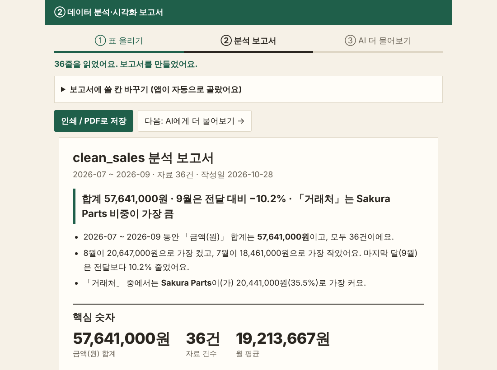
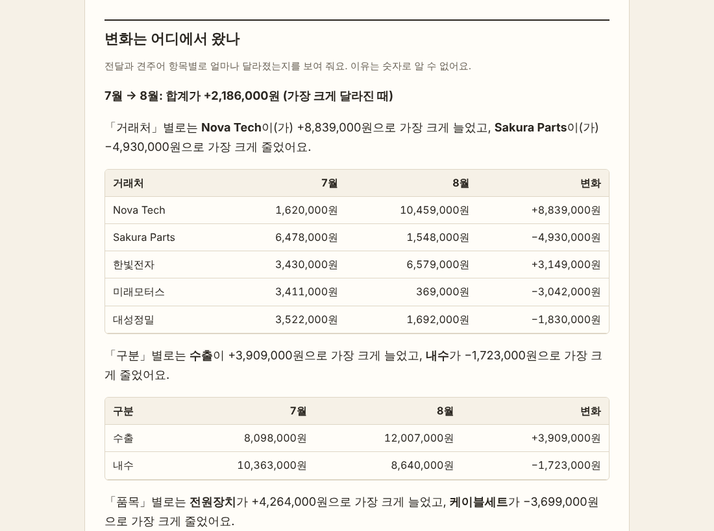
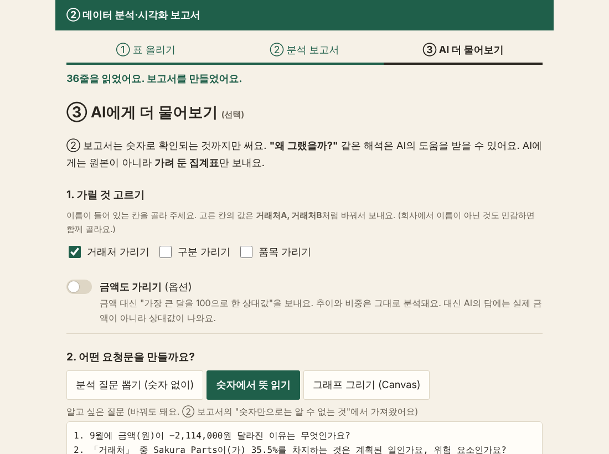
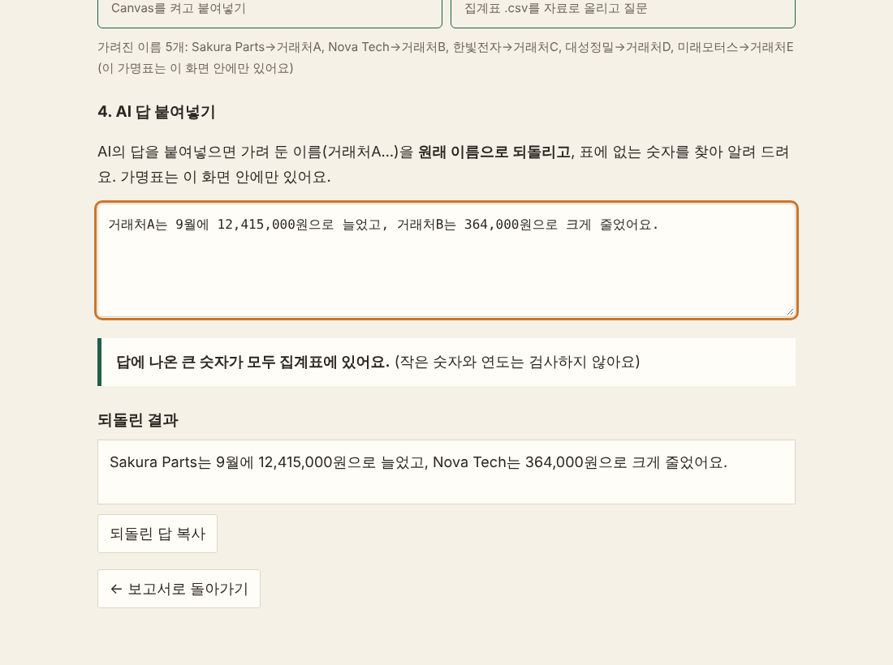
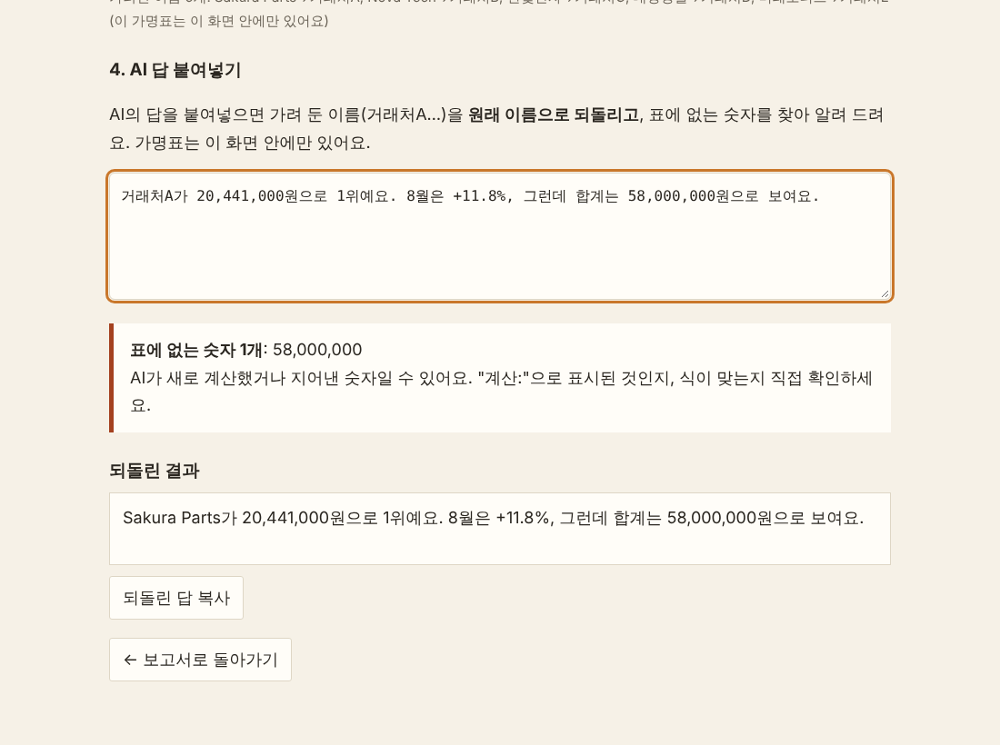

# 🔍 AI를 활용한 데이터 분석 및 시각화

> ② 단원 · 45분 · 결과물: 분석 보고서, 이름을 가려서 AI에게 받은 분석, 검산까지 끝낸 답

이 문서만 보고 따라 하면, 정리된 매출표를 **`2_분석시각화앱.html`** 에 올려 **AI 없이 계산한 분석 보고서**를 만들고, 그 숫자로 **이름을 가려서** Gemini에게 "왜 그랬을까?"를 물어본 뒤, AI의 답에 **틀린 숫자가 없는지 직접 검산**하는 것까지 완성합니다.

<div data-callout="info">

**🎓 자격증 연결:** 이 단원은 연습 문제 **5번(민감 정보 가리기), 9번(환각), 10번(AI 결과는 확인하고 쓰기)** 과 이어집니다.

</div>

## 시작하기 전에 준비하세요

- [ ] `2_분석시각화앱.html` 파일 (더블클릭하면 브라우저에서 열려요)
- [ ] ①단원에서 앱①으로 만든 **`매출 (수출입)_정리됨.csv`** 파일 (없으면 앱의 "연습용 자료로 해 보기"를 쓰면 돼요)
- [ ] 무료 Gemini(또는 ChatGPT) 새 대화 창 하나
- [ ] 메모할 수 있는 빈 문서

## 오늘의 진행 순서 (한눈에 보기)

| STEP | 할 일 | 시간 |
|---|---|---|
| 1 | 앱②에 정리된 표 올리고 분석 보고서 만들기 | 7분 |
| 2 | 보고서 읽기: 숫자로 알 수 있는 것과 알 수 없는 것 | 8분 |
| 3 | 이름을 가려서 AI에게 보낼 요청문 만들기 | 7분 |
| 4 | Gemini에게 물어보고 답 붙여넣기 | 10분 |
| 5 | AI 답의 숫자 검산하기 | 8분 |
| 6 | 질문에 맞는 그래프 고르기 | 5분 |

---

## STEP 1. 앱②에 표 올리고 분석 보고서 만들기 (7분)

앱②는 **AI를 쓰지 않아요.** 내 컴퓨터 안에서 규칙으로 계산해서 **분석 보고서**를 만들어 줍니다.

**따라 하기**

1. `2_분석시각화앱.html`을 더블클릭해 여세요. 위쪽에 `① 표 올리기 / ② 분석 보고서 / ③ AI 더 물어보기`가 보입니다.
2. 앱①에서 받은 **`매출 (수출입)_정리됨.csv`** 를 화면의 점선 칸으로 **끌어다 놓으세요.** (파일이 없으면 아래 **"연습용 자료로 해 보기"** 의 **`매출 (수출입)`** 버튼을 누르세요.)
3. `36줄을 읽었어요. 보고서를 만들었어요.`가 나오고 `② 분석 보고서`가 열리면 성공입니다.
4. 보고서 맨 위의 **한 줄 결론**을 읽어 보세요.

   > 합계 57,641,000원 · 9월은 전달 대비 −10.2% · 「거래처」는 Sakura Parts 비중이 가장 큼



💡 **쉬운 설명/예시:** 앱①이 "표를 깨끗하게 만드는 도구"라면, 앱②는 **"깨끗한 표를 읽어 주는 도구"** 예요. 월별로 어떻게 변했는지, 어디서 변화가 왔는지, 한쪽에 쏠려 있지는 않은지를 **계산으로** 알려 줘요. 정리가 안 된 표를 올리면 앱이 "똑같은 줄이 있어요. 앱①에서 지우고 오면 합계가 정확해요"라고 알려 줘요.

📝 **직접 입력해보기**

| 보고서 맨 위에서 찾은 것 | 내가 읽은 숫자 |
|---|---|
| 자료 건수 (정답: 36건) | |
| 전체 합계 (정답: 57,641,000원) | |
| 한 줄 결론에 나온 1위 거래처 | |

---

✅ **체크리스트**
- [ ] `36줄을 읽었어요. 보고서를 만들었어요.`가 보인다
- [ ] 한 줄 결론에 `57,641,000원`이 있다

---

## STEP 2. 보고서 읽기: 숫자로 알 수 있는 것과 알 수 없는 것 (8분)

보고서는 아래로 스크롤하며 읽어요. **앱이 계산으로 확인해 주는 것**과, **사람이나 AI에게 물어봐야 하는 것**을 구분하는 연습을 합니다.

**따라 하기**

1. 보고서를 아래로 내리면서 각 제목을 찾고, 아래 표의 숫자와 같은지 비교하세요.

   | 보고서 제목 | 눈여겨볼 숫자 (예시) |
   |---|---|
   | **핵심 숫자** | 합계 57,641,000원 / 36건 / 월 평균 19,213,667원 / 가장 큰 한 건 6,136,000원 |
   | **월별 추이** | 7월 18,461,000 → 8월 20,647,000(+11.8%) → 9월 18,533,000(−10.2%) |
   | **변화는 어디에서 왔나** | 7월→8월 합계 +2,186,000원: 구분별로 **수출 +3,909,000**, **내수 −1,723,000** |
   | **「거래처」별 구성과 쏠림** | 1위 Sakura Parts 35.5%, 상위 3개 75.1% → "1위 비중이 큰 편이에요" |
   | **「구분」별 구성과 쏠림** | "항목이 2개뿐이라 쏠림은 판단하지 않아요" |
   | **구성은 어떻게 달라졌나** | 수출 비중 43.9% → 69.0% (7월 → 9월) |
   | **튀는 값** | 8월 +11.8%, 9월 −10.2%, 가장 큰 한 건 = 전체의 10.6% (2026-09-13 Sakura Parts 전원장치 6,136,000원) |

2. **"숫자만으로는 알 수 없는 것"** 항목을 찾아 읽으세요. 앱이 질문 목록을 만들어 줍니다. 예:
   - `9월에 금액(원)이 −2,114,000원 달라진 이유는 무엇인가요?`
   - `「구분」의 수출 비중이 43.9%에서 69.0%로 바뀐 이유는 무엇인가요?`
3. 그 아래 **"내 해석 (직접 쓰기)"** 칸에 내 생각을 한 줄 적어 보세요.
4. 위쪽 **[인쇄 / PDF로 저장]** 을 눌러 보세요. 보고서만 A4로 인쇄(PDF 저장)돼요. 설정 칸과 버튼은 인쇄에 나오지 않아요. (미리보기만 보고 닫아도 돼요.)



💡 **쉬운 설명/예시:** 앱은 **"무엇이 변했나"** 는 정확히 말해요. 예를 들어 "8월에 늘어난 건 수출 쪽이에요(+3,909,000원)"까지는 계산으로 알아요. 하지만 **"왜 수출이 늘었나"** 는 숫자만으로는 알 수 없어요. 신규 주문 때문인지, 환율 때문인지는 담당자나 AI가 짐작해 봐야 해요. 이 구분이 오늘의 핵심이에요.

| 질문 | 누가 답할 수 있나 |
|---|---|
| 8월에 얼마나 늘었나? | **앱** (계산으로 확인) |
| 어느 구분에서 늘었나? | **앱** (계산으로 확인) |
| **왜** 수출이 늘었나? | **사람이나 AI** (숫자만으로 알 수 없음) |

<div data-callout="info">

**참고:** 보고서 아래쪽 **"계산 방법"** 에 기준이 적혀 있어요. 예를 들어 "1위가 40% 이상이면 쏠림, 한 건이 전체의 10% 이상이면 튀는 값"처럼 **정해 둔 숫자**일 뿐 정답은 아니에요. 필요하면 보고서 위쪽 **"보고서에 쓸 칸 바꾸기"** 에서 날짜 칸, 숫자 칸, 묶어 볼 칸을 바꿀 수 있어요.

</div>

📝 **직접 입력해보기**

| 질문 | 내 답 |
|---|---|
| 앱이 계산으로 알려 준 것 한 가지는? (예: 8월에 +2,186,000원 늘었다) | |
| 숫자만으로는 알 수 없어서 물어봐야 하는 것 한 가지는? | |

---

✅ **체크리스트**
- [ ] 보고서에서 `변화는 어디에서 왔나`와 `튀는 값`을 찾았다
- [ ] "무엇이 변했나"와 "왜 변했나"를 구분해서 설명할 수 있다
- [ ] `내 해석` 칸에 한 줄 적었다

---

## STEP 3. 이름을 가려서 AI에게 보낼 요청문 만들기 (7분)

"왜 그랬을까?"는 AI의 도움을 받을 수 있어요. 하지만 **거래처 이름과 원본 줄을 그대로 보내면 안 돼요.** 앱이 **이름을 가려서(가명으로 바꿔서) 집계표만** 보낼 요청문을 만들어 줍니다.

**따라 하기**

1. 보고서 위쪽의 **[다음: AI에게 더 물어보기 →]** 를 누르세요. (또는 위의 `③ AI 더 물어보기` 단계)
2. **"1. 가릴 것 고르기"** 에서 **`거래처 가리기`** 에 체크되어 있는지 확인하세요. (이름이 들어 있는 칸은 앱이 자동으로 골라 줘요.)
3. 화면 아래의 **"가려진 이름 5개"** 안내를 읽어 보세요.

   | 진짜 이름 | 요청문에서 보이는 이름 |
   |---|---|
   | Sakura Parts | 거래처A |
   | Nova Tech | 거래처B |
   | 한빛전자 | 거래처C |
   | 대성정밀 | 거래처D |
   | 미래모터스 | 거래처E |

   이 **가명표는 이 화면 안에만 있어요.** 컴퓨터 밖으로 나가지 않습니다.
4. **"2. 어떤 요청문을 만들까요?"** 에서 **`숫자에서 뜻 읽기`** 를 누르세요.
5. **"3. AI에게 보낼 요청문"** 상자에 요청문이 만들어집니다. 아래쪽 `[분석 질문]` 칸에는 STEP 2에서 본 "숫자만으로는 알 수 없는 것"이 들어가 있어요. 마음대로 고쳐도 돼요.
6. (선택) **`금액도 가리기`** 를 켜 보세요. 금액이 "가장 큰 달 = 100" 같은 **상대값**으로 바뀝니다. 추이와 비중은 그대로 분석돼요. 대신 AI의 답에는 실제 금액이 아니라 상대값이 나와요. **금액 자체가 비밀일 때** 켜세요.



💡 **쉬운 설명/예시:** **마스킹(가리기)** 은 편지에서 이름을 가리고 보내는 것과 같아요. AI는 "거래처A가 35.5%"만 알고, 그게 어느 회사인지는 몰라요. 그리고 **원본 36줄이 아니라 집계표 몇 줄만** 보내서 노출을 더 줄여요. (**최소한만 보낸다**는 원칙이에요.) 답이 돌아오면 앱이 "거래처A → Sakura Parts"로 되돌려 줘요.

<div data-callout="warning">

**주의:** 마스킹을 해도 **회사의 AI 사용 규정이 먼저**예요. 오늘은 가짜 연습 자료라서 괜찮지만, 내 업무 자료는 규정을 먼저 확인하세요.

</div>

<div data-callout="info">

**🎓 자격증 연결 (5번):** 외부 AI에 회사 자료를 넣을 때는 **이름·금액 같은 민감한 정보를 가리거나 빼고 입력**합니다. 원본을 통째로 넣는 것보다 **집계표만** 넣는 것이 더 안전해요.

</div>

📝 **직접 입력해보기**

| 질문 | 내 답 |
|---|---|
| 가려진 이름은 몇 개인가요? (정답: 5개) | |
| 거래처A는 실제로 누구인가요? | |
| 내 업무 자료라면 이름 외에 가려야 할 칸이 또 있을까요? | |

---

✅ **체크리스트**
- [ ] `거래처 가리기`가 체크되어 있고 "가려진 이름 5개"를 확인했다
- [ ] 요청문 상자에 `거래처A`는 보이고 `Sakura Parts`는 보이지 않는다
- [ ] 원본 줄이 아니라 집계표만 들어 있음을 확인했다

---

## STEP 4. Gemini에게 물어보고 답 붙여넣기 (10분)

만들어진 요청문을 Gemini에 보내고, 답을 앱에 붙여넣어 **이름을 되돌립니다.**

**따라 하기**

1. 요청문 상자 아래 **[요청문 복사하기]** 를 누르세요. `복사했어요 ✓`가 나옵니다.
2. 오른쪽(또는 아래)의 **`Gemini 열기`** 를 눌러 새 대화를 열고, 입력창에 **붙여넣기(Ctrl+V)** 한 뒤 Enter를 누르세요.
3. 답이 나오면 읽어 보세요. 질문마다 **관찰 → 근거 숫자 → 해석(추정:) → 더 확인할 것** 4칸으로 답하는지 보세요.
4. AI의 답 **전체를 복사**하세요.
5. 앱의 **"4. AI 답 붙여넣기"** 칸에 붙여넣으세요.
6. **"되돌린 결과"** 상자에서 `거래처A`가 `Sakura Parts`로 바뀌어 있는지 확인하세요. 마음에 들면 **[되돌린 답 복사]** 를 눌러 내 문서에 붙여 쓰세요.



**앱이 만들어 준 요청문 (일부)**

```
[역할]
너는 제조 회사 경영지원팀의 데이터 분석 선배야. 임원이 결정할 수 있게 분석해 주는 사람이야.

[재료: 확인된 집계표. 이름은 가려 둔 가명이야(예: 거래처A). 가명을 원래 이름으로 추측하려 하지 마.]
기간: 2026-07 ~ 2026-09
### 월별 금액(원)
| 월 | 금액(원) | 건수 | 전달 대비 |
|---|---|---|---|
| 7월 | 18,461,000 | 12 | - |
| 8월 | 20,647,000 | 12 | +11.8% |
| 9월 | 18,533,000 | 12 | −10.2% |

### 거래처별 금액(원)
| 거래처 | 금액(원) | 비중 | 건수 |
|---|---|---|---|
| 거래처A | 20,441,000 | 35.5% | 11 |
| 거래처B | 12,443,000 | 21.6% | 8 |
...

[분석 질문]
1. 9월에 금액(원)이 −2,114,000원 달라진 이유는 무엇인가요?
2. 「거래처」 중 거래처A이(가) 35.5%를 차지하는 것은 계획된 일인가요, 위험 요소인가요?
...

[규칙]
- 숫자는 [재료]에 있는 것만 써. 모르는 숫자는 만들지 마.
- 관찰, 근거 숫자, 해석을 한 문장에 섞지 마.
```

💡 **쉬운 설명/예시:** 이 요청문도 **시작하기 단원 STEP 3에서 배운 6칸 틀**로 만들어졌어요.
- `[역할]` 분석 선배 → 누가 답하는지
- `[재료]` 가려 둔 집계표 → 무엇을 근거로
- `[분석 질문]`(할 일) → 무엇을 물을지
- `[규칙]` "숫자는 [재료]에 있는 것만" → 지어내지 못하게
- `[마지막 검사]` "근거 없음이 0개인지" → 스스로 확인

**AI의 답은 이런 모습이에요 (예시. 실제 답은 조금씩 달라요)**

```
1. 9월에 금액이 줄어든 이유
- 관찰: 9월 합계는 18,533,000원으로 8월(20,647,000원)보다 줄었다.
- 근거 숫자: 20,647,000 → 18,533,000 (계산: 18,533,000 − 20,647,000 = −2,114,000, −10.2%)
- 해석: 추정: 거래처A의 9월 주문은 늘었지만(12,415,000원) 거래처B의 주문이 크게 줄어서(364,000원) 전체가 줄었을 수 있다.
- 더 확인할 것: 거래처B의 9월 주문이 줄어든 이유(계약 종료? 납기 이동?)
```

📝 **직접 입력해보기**

| 질문 | 내 답 |
|---|---|
| AI의 답에서 "추정:"으로 시작한 문장이 있었나요? 한 줄 옮겨 적어 보세요 | |
| 되돌린 결과에서 `거래처A`는 어느 회사로 바뀌었나요? | |

---

✅ **체크리스트**
- [ ] 요청문을 Gemini에 붙여넣어 답을 받았다
- [ ] 답을 앱의 "AI 답 붙여넣기" 칸에 붙여넣어 이름이 되돌아온 것을 보았다
- [ ] AI가 "관찰/근거/해석(추정:)/더 확인할 것"으로 나눠 답했는지 확인했다

---

## STEP 5. AI 답의 숫자 검산하기 (8분)

AI는 **환각(할루시네이션)** 으로 없는 숫자를 그럴듯하게 말할 수 있어요. 앱의 **숫자 검사**로 잡아 봅니다.

**따라 하기**

1. 이번에는 아래 **가짜 AI 답**을 복사해서 앱의 **"AI 답 붙여넣기"** 칸에 붙여넣으세요. (일부러 틀린 숫자를 하나 넣었어요.)

   ```
   거래처A가 20,441,000원으로 1위예요. 8월은 +11.8%, 그런데 합계는 58,000,000원으로 보여요.
   ```

2. 붙여넣자마자 아래에 이런 안내가 나옵니다.

   > **표에 없는 숫자 1개**: 58,000,000
   > AI가 새로 계산했거나 지어낸 숫자일 수 있어요. "계산:"으로 표시된 것인지, 식이 맞는지 직접 확인하세요.

3. 보고서의 **전체 합계**를 확인하세요. 정답은 **57,641,000원**이에요. AI의 "58,000,000원"은 틀렸어요.
4. 문장을 **58,000,000 → 57,641,000** 으로 고쳐서 다시 붙여넣으면 안내가 `답에 나온 큰 숫자가 모두 집계표에 있어요`로 바뀝니다.
5. 내 실제 AI 답(STEP 4)도 붙여넣어 보세요. 안내에 나온 숫자가 있다면 하나씩 **"계산:"으로 표시한 숫자인지, 식이 맞는지** 확인하세요.



💡 **쉬운 설명/예시:** 앱의 숫자 검사는 **"표에 있는 숫자인가"** 를 확인해요. AI가 `계산: 18,533,000 − 20,647,000 = −2,114,000`처럼 새로 계산한 값은 표에 없어서 안내에 나올 수 있어요. 이때는 **식을 내 계산기로 다시 해 보면** 됩니다. 식이 맞으면 OK, 틀리면 AI가 틀린 거예요. 이 확인은 **AI가 아니라 내가** 해야 해요. AI에게 "틀리지 마"라고 다시 말해도 소용이 없어요. 업무 결과의 **책임은 사람에게** 있어요.

<div data-callout="warning">

**주의:** 앱의 숫자 검사는 **1,000 이상의 큰 숫자와 소수·퍼센트 숫자만** 검사해요. 작은 숫자(예: "3곳")와 연도는 검사하지 않아요. 그리고 숫자가 맞아도 **해석(왜 그랬나)** 이 맞는지는 알 수 없어요. 해석은 "추정"이라는 점을 잊지 마세요.

</div>

<div data-callout="info">

**🎓 자격증 연결 (9번·10번):**
- **9번:** AI가 사실이 아닌 내용을 사실처럼 그럴듯하게 만들어 내는 현상 = **환각(할루시네이션)**.
- **10번:** AI가 만든 결과(글·숫자·그래프)는 업무에 쓰기 전에 **사람이 사실과 숫자를 직접 확인(검산)** 한 뒤 씁니다. 그럴듯해 보인다고 그대로 쓰거나, "틀리지 마"라고 말했으니 확인하지 않아도 된다는 생각은 틀렸어요. 책임은 AI가 아니라 **사람**에게 있어요.

</div>

📝 **직접 입력해보기**

| 질문 | 내 답 |
|---|---|
| 앱이 잡아낸 틀린 숫자는? (정답: 58,000,000) | |
| 보고서의 올바른 전체 합계는? (정답: 57,641,000) | |
| AI가 쓴 숫자를 내가 직접 확인해야 하는 이유 한 문장 | |

---

✅ **체크리스트**
- [ ] 일부러 틀린 숫자(`58,000,000`)를 앱이 잡아내는 것을 보았다
- [ ] 보고서의 올바른 합계(`57,641,000`)로 고쳐서 `모두 집계표에 있어요`를 확인했다
- [ ] AI의 계산식은 내가 다시 계산해 본다는 것을 설명할 수 있다

---

## STEP 6. 질문에 맞는 그래프 고르기 (5분)

그래프는 **예쁜 것**이 아니라 **질문에 맞는 것**을 고릅니다. 틀린 그래프는 틀린 이야기를 해요.

**따라 하기**

1. 아래 표를 읽고, 내 질문에 맞는 그래프를 골라 보세요.

   | 질문의 종류 | 맞는 그래프 | 피할 그래프 |
   |---|---|---|
   | 시간에 따라 어떻게 변했나 | 꺾은선 (월이 적으면 세로 막대) | 원그래프 |
   | 여러 개를 견주면 | 막대 | 3차원 그래프 |
   | 1등부터 순위를 보려면 | 큰 순서로 정렬한 가로 막대 | 원그래프 |
   | 전체에서 몇 %인가 | 100%로 쌓은 막대 하나 | 항목이 많은 원 |
   | 두 가지가 같이 움직이나 | 점 그래프 | 막대 두 개 나란히 |

2. 앱의 **"③ AI 더 물어보기"** 에서 **"2. 어떤 요청문을 만들까요?"** 의 **`그래프 그리기 (Canvas)`** 를 누르세요.
3. **"어떤 표를 그릴까요?"** 에서 `월별 금액(원)`을 고르고, 질문 칸에 이렇게 쓰세요.

   ```
   월마다 금액이 어떻게 달라졌나?
   ```

4. 만들어진 요청문을 복사하세요. (Gemini의 **Canvas**를 켜서 붙여넣으면 그래프 웹페이지를 만들어 줘요. **Canvas 메뉴의 이름과 위치는 바뀔 수 있으니, 안 보이면 손을 들어 알려 주세요.**)
5. 만들어진 그래프에서 **세로축이 0부터 시작하는지**, **값 이름표가 막대 끝에 있는지**를 확인하세요.

💡 **쉬운 설명/예시:** 7월 18,461,000원과 8월 20,647,000원은 사실 11.8%밖에 차이 나지 않아요. 그런데 세로축을 **18,000,000에서 시작**하면 8월 막대가 7월의 몇 배처럼 보여요. 그래서 요청문에 **"세로축은 반드시 0부터 시작해"** 라는 규칙을 넣은 거예요. (규칙 한 줄이 그래프의 거짓말을 막아요.)

📝 **직접 입력해보기**

| 질문 | 내 답 |
|---|---|
| "1등 거래처는 어디인가?" 에 맞는 그래프는? | |
| "월마다 금액이 어떻게 변했나?" 에 맞는 그래프는? | |
| 막대 그래프의 세로축을 0부터 시작해야 하는 이유는? | |

---

✅ **체크리스트**
- [ ] 질문 종류별로 맞는 그래프를 말할 수 있다
- [ ] `그래프 그리기 (Canvas)` 요청문을 만들어 복사했다
- [ ] 그래프의 세로축이 0부터인지 확인하는 습관을 알았다

📌 **오늘 배운 것 정리**
- 앱②는 AI 없이 **무엇이 변했는지**를 계산해요. **왜 변했는지**는 사람이나 AI가 짐작해야 해요.
- AI에게는 **이름을 가리고, 원본이 아니라 집계표만** 보냅니다. (자격증 5번)
- AI의 답에는 **환각**으로 틀린 숫자가 있을 수 있어서, **내가 직접 검산**해야 해요. (자격증 9번·10번)
- 요청문 **6칸 틀**과 **"하지 마" 규칙**은 분석에도 그대로 써요.
- 그래프는 **질문 종류**에 맞춰 고르고, 막대 그래프의 세로축은 **0부터** 시작해요.

## 용어 사전

| 용어 | 쉬운 뜻 |
|---|---|
| 분석 | 숫자에서 변화와 이유를 읽어 내는 일 |
| 시각화 | 숫자를 그래프로 보기 쉽게 그리는 일 |
| 기여도(변화는 어디에서 왔나) | 전체가 변했을 때 어느 항목이 얼마나 변하게 만들었는지 |
| 쏠림 | 한두 항목이 전체의 큰 몫을 차지하는 것 |
| 비중 | 전체 중에서 차지하는 몫(%) |
| 마스킹 (가리기) | 이름을 거래처A처럼 가짜 이름으로 바꾸는 것 |
| 집계표 | 월별·항목별 합계만 모은 표 |
| 환각 (할루시네이션) | AI가 사실이 아닌 내용을 그럴듯하게 말하는 현상 |
| 검산 | AI가 쓴 숫자를 내가 직접 다시 계산해 맞는지 확인하는 일 |
| 추정 | 확인되지 않은 이유를 짐작하는 것 (AI의 해석은 추정으로 표시) |
